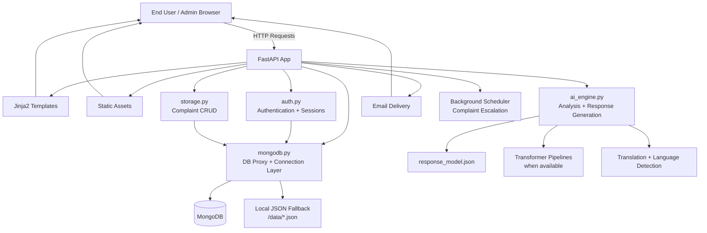
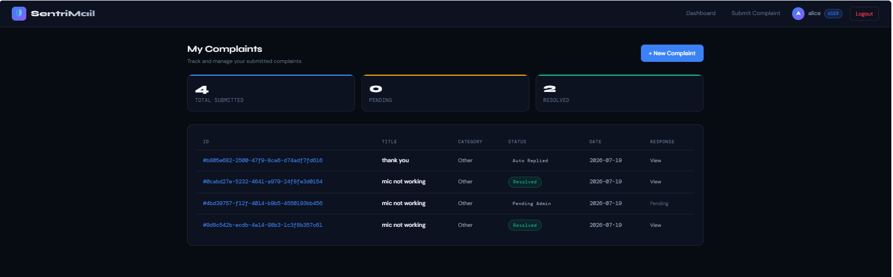
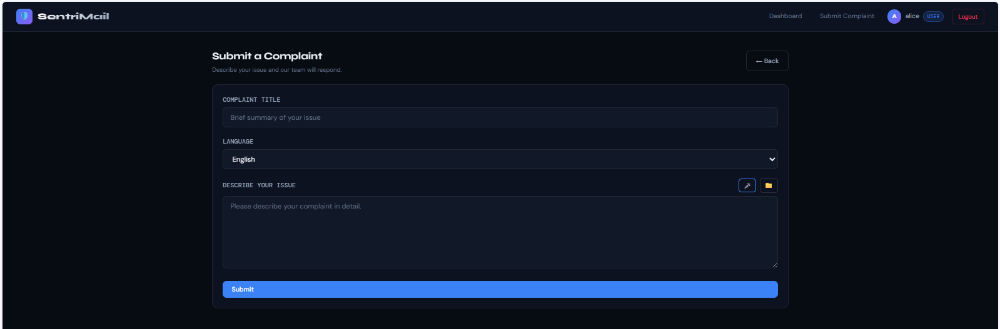
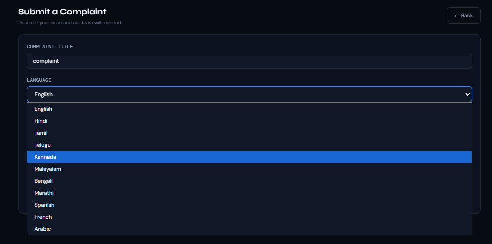
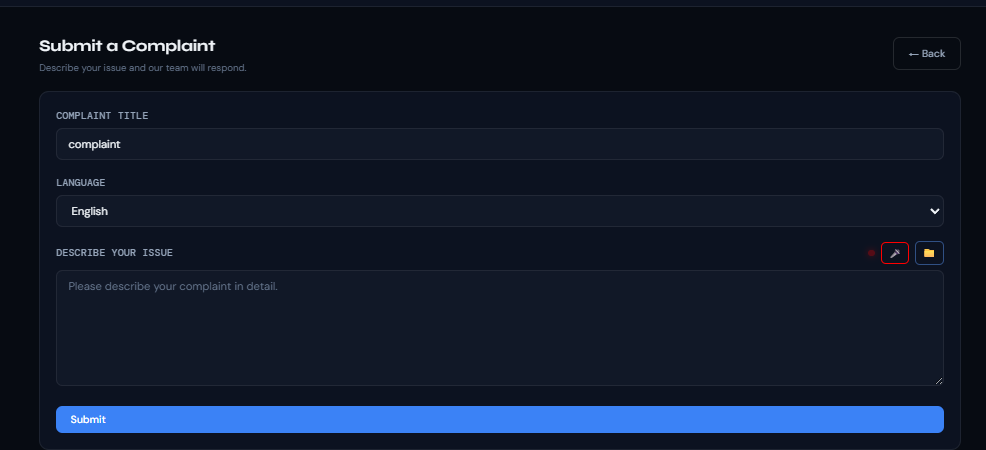
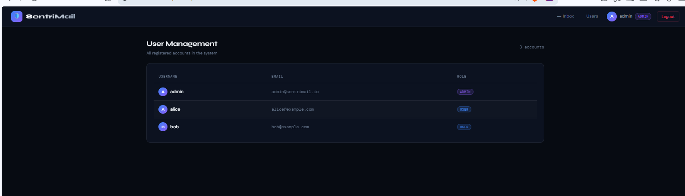

# SentriMail - AI Complaint Management System

SentriMail is a role-based complaint management platform that combines workflow automation, multilingual support, AI-assisted triage, and admin resolution tools. It is designed as a portfolio-ready system that shows both product thinking and engineering depth.

## Overview

SentriMail lets users submit complaints, track them with a complaint code, and receive automated support for low-priority cases. Admins get a prioritized inbox, complaint-level analysis, response drafting support, user management, and CSV export. The app is built with FastAPI and Jinja2, uses MongoDB when available, and falls back to local JSON storage if MongoDB is offline.

## Key Capabilities

- Role-based access for admin and user accounts.
- Complaint submission with language detection and translation to English for analysis.
- AI-assisted sentiment, emotion, priority, and root-cause analysis.
- Automatic handling of low-risk complaints with AI-generated reply text.
- Admin workflow for reviewing, updating status, and sending resolution responses.
- Complaint tracking via complaint code.
- User dashboard and admin dashboard with priority-based visibility.
- CSV export for admin reporting.
- Login event logging and session-cookie authentication.
- MongoDB-backed storage with local JSON fallback for offline development.

## System Architecture



### Architecture Notes

- `app/main.py` is the orchestration layer that wires routes, startup initialization, escalation jobs, translation, email delivery, and template rendering.
- `app/auth.py` handles password hashing, session tokens, default account seeding, and access checks.
- `app/storage.py` manages complaint persistence and complaint-code generation.
- `app/ai_engine.py` computes sentiment, emotion, priority, auto-resolvability, root-cause summaries, and response suggestions.
- `app/mongodb.py` abstracts persistence and switches to local JSON files when MongoDB is unavailable.

## Complaint Workflow

1. A user submits a complaint from the UI.
2. The app detects the language and translates the complaint to English if required.
3. The AI engine analyzes the complaint for sentiment, emotion, priority, and likely root cause.
4. Low-priority complaints may be auto-resolved with a generated response.
5. Higher-priority complaints are routed to the admin dashboard.
6. Admins can review the complaint, update the status, write a response, and trigger an email reply.
7. The complaint remains trackable through its generated complaint code.

## Application In Action

The screenshots below were captured while the project was running and are stored in [working_images](working_images). They are arranged as a product walkthrough so interviewers can see the actual user journey, not just isolated UI snapshots.

### 1. Login And Role Routing

The login screen is the entry point for both admins and users. After authentication, the app redirects each role to its own dashboard.


### 2. User Dashboard And Complaint Submission

The user dashboard shows complaint history and status. From there, a user can submit a new complaint and begin the AI-assisted workflow.





### 3. Multilingual And Voice-Based Intake

SentriMail supports complaints written in different languages and also includes voice-based capture in the running demo. The app detects language, translates text to English for analysis, and preserves the original context for the user.





### 4. Admin Dashboard, Inbox, And Analytics

The admin console is where complaints are prioritized, reviewed, and resolved. The dashboard presents the queue, analytics, and complaint visibility needed for operational handling.


### 5. User Administration

Admins can also manage users from the same system, which helps demonstrate that the app is not limited to complaint intake alone.



## Screenshot Notes

- Every image above comes from the repository’s [working_images](working_images) folder.
- The README uses direct relative paths so the screenshots render correctly inside GitHub.
- File names contain spaces, so the links are URL-encoded to keep them clickable and portable.

## Tech Stack

- Backend: FastAPI, Uvicorn
- Templating: Jinja2
- AI/ML: HuggingFace Transformers, rule-based fallback analysis
- Language support: langdetect, deep-translator
- Database: MongoDB via PyMongo, with local JSON fallback
- Scheduling: APScheduler
- Email: SMTP
- Auth: Cookie-based sessions + SHA-256 password hashing

## Project Structure

```text
Sentrimail/
├── app/
│   ├── main.py           # FastAPI routes and application flow
│   ├── auth.py           # Authentication, sessions, user helpers
│   ├── ai_engine.py      # Complaint analysis and response generation
│   ├── storage.py        # Complaint persistence helpers
│   └── mongodb.py        # MongoDB connection and local fallback layer
├── data/                 # JSON fallback storage and response model
├── static/               # Static assets
├── templates/            # Jinja2 views
├── working_images/       # Screenshots for README and portfolio presentation
├── run.py                # Local app launcher
├── requirements.txt      # Python dependencies
└── README.md
```

## Setup

### 1. Install dependencies

```bash
pip install -r requirements.txt
```

### 2. Configure environment variables

PowerShell example:

```powershell
$env:MONGODB_URI="mongodb://localhost:27017"
$env:MONGODB_DB_NAME="sentrimail"
```

Optional mail settings for resolution emails:

```powershell
$env:MAIL_SERVER="localhost"
$env:MAIL_PORT="587"
$env:MAIL_USE_TLS="False"
$env:MAIL_USERNAME=""
$env:MAIL_PASSWORD=""
$env:MAIL_DEFAULT_SENDER="noreply@sentrimail.com"
```

### 3. Start the app

```bash
python run.py
```

### 4. Open the application

```text
http://localhost:8000
```

## Default Accounts

These accounts are seeded automatically on startup:

- Admin: `admin` / `admin123`
- User: `alice` / `alice123`
- User: `bob` / `bob123`

## MongoDB and Fallback Storage

SentriMail initializes its database layer on startup and performs a connection ping. If MongoDB is available, the app uses the configured database and creates the required indexes for users, complaints, and login logs. If MongoDB cannot be reached, the app switches to local JSON storage inside the [data](data) folder so the project remains runnable for demos and development.

## Main Routes

- `/` - role-based landing redirect.
- `/login` - login form and session creation.
- `/register` - user registration.
- `/logout` - session termination.
- `/user/dashboard` - user complaint dashboard.
- `/user/submit` - complaint submission.
- `/track` - complaint tracking by complaint code.
- `/admin/dashboard` - admin queue and analytics view.
- `/admin/complaint/{complaint_id}` - complaint detail view.
- `/admin/users` - user management.
- `/admin/export` - CSV export of complaints.

## Why This Project Is Strong For Interviews

- It demonstrates full-stack design rather than a single isolated feature.
- It includes a real workflow with role separation, state transitions, and traceable complaint codes.
- It shows practical AI integration with fallback logic, not just a model call.
- It includes multilingual handling, email delivery, and scheduled escalation.
- It has a strong presentation story with screenshots and an architecture diagram.

## Notes

- The AI pipeline can use Transformer models when they are available, but it degrades gracefully to rule-based analysis when they are not.
- Some older records can be backfilled so admin views stay consistent.
- The complaint export includes language, translation, priority, sentiment, and resolution fields for reporting.
