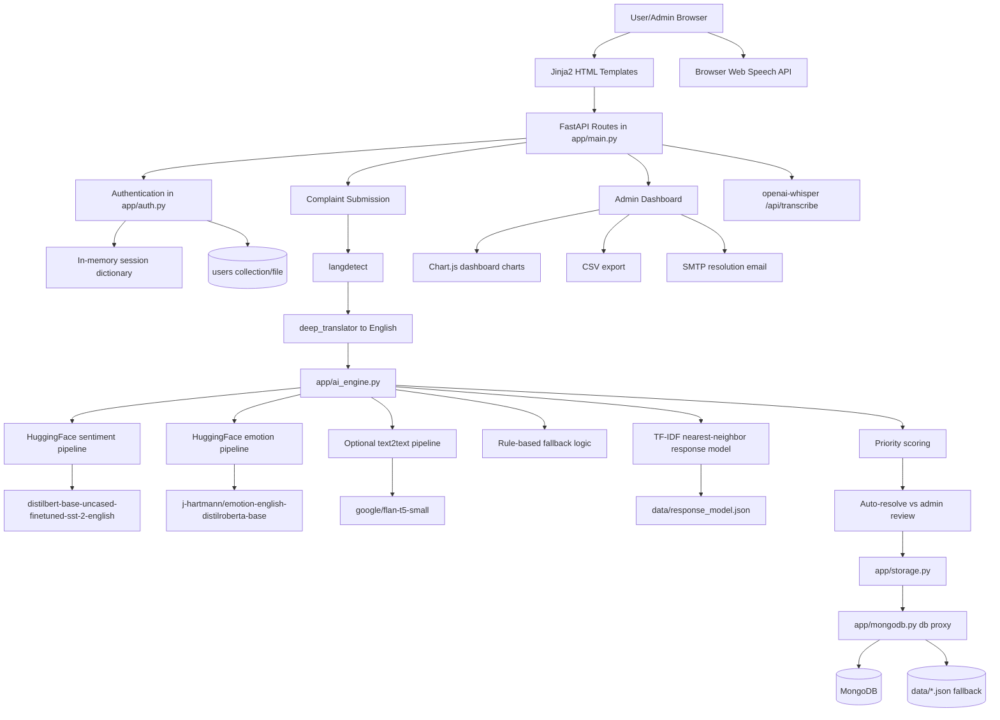
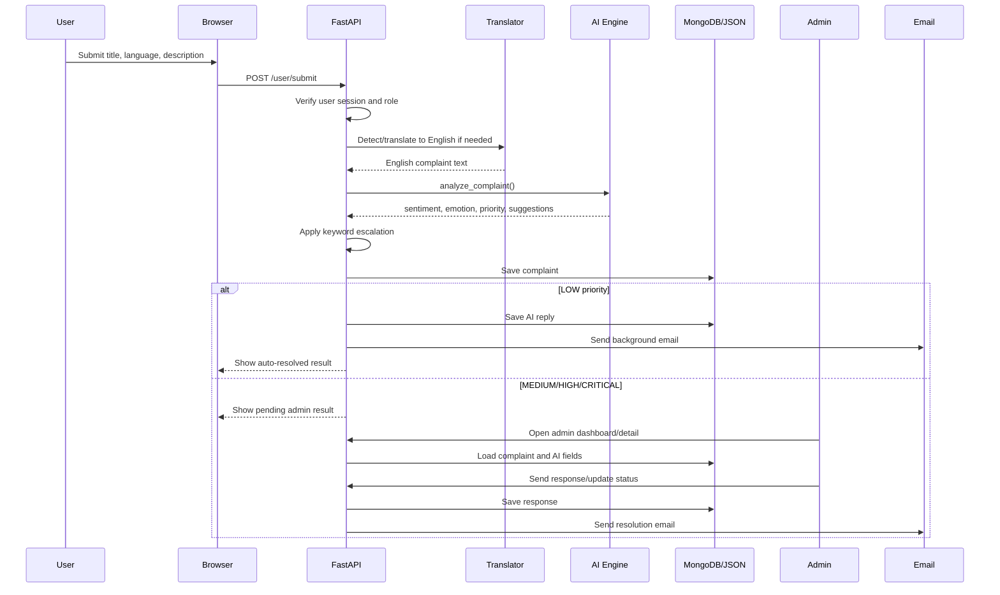
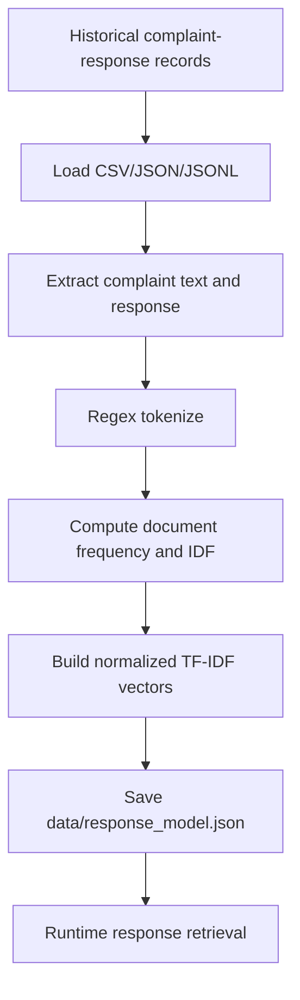
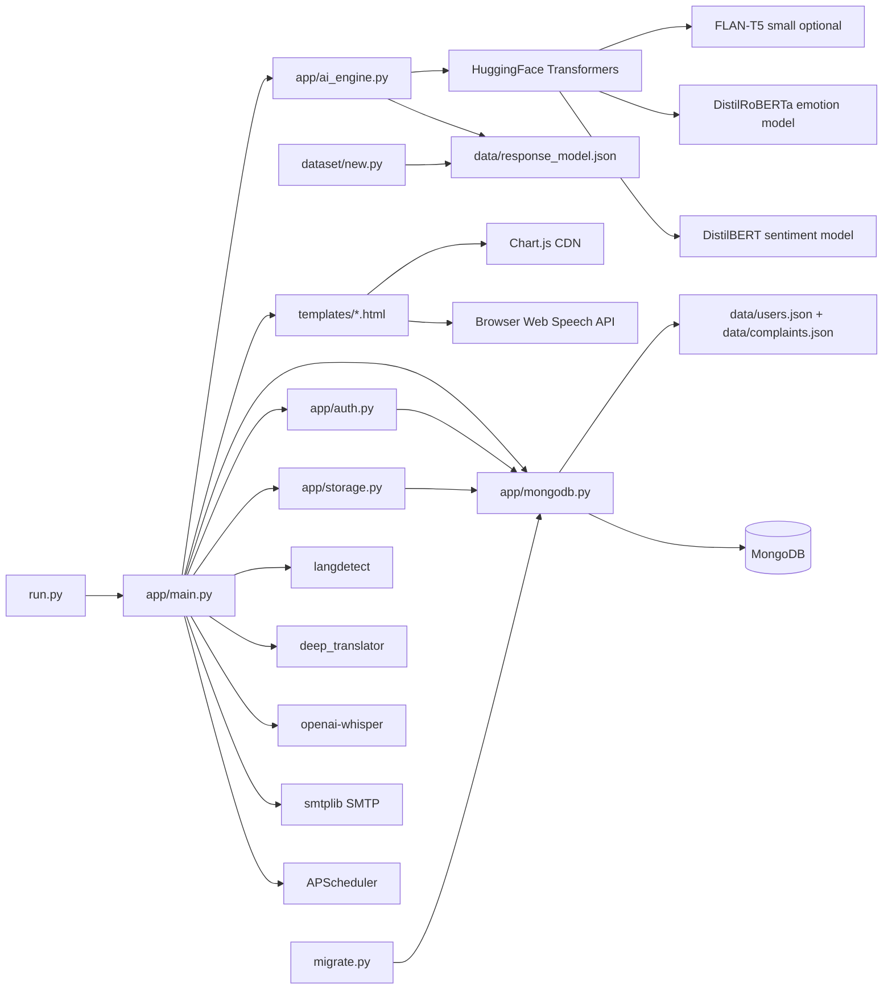

# SentriMail Interview Preparation and Engineering Forensic Report

This document is an interview-ready technical reference for the SentriMail repository. It follows the requested forensic-report structure, but it is corrected for the actual project: SentriMail is not a computer-vision project. It is a FastAPI-based AI complaint management system using NLP, translation, speech transcription, MongoDB persistence, and role-based dashboards.

## 1. Executive Summary

SentriMail solves the problem of receiving, analyzing, prioritizing, tracking, and responding to user complaints. Instead of every complaint going directly into an unstructured inbox, the system applies AI-assisted triage: it detects sentiment, detects emotion, computes a priority score, generates root-cause text, suggests an admin response, and can auto-reply to low-risk complaints.

The architecture was chosen because it is practical for a student/demo project and still resembles a real business workflow. FastAPI provides a lightweight backend, Jinja2 templates provide server-rendered pages, MongoDB stores operational data, and HuggingFace Transformers add NLP intelligence. The code also includes fallbacks: if MongoDB is unavailable, local JSON storage is used; if transformer models fail to load, rule-based sentiment and emotion logic is used.

The target users are:

| User type | Goal |
|---|---|
| Customer/user | Register, log in, submit complaints, track status, view replies |
| Admin/support team | Review complaints, see AI analysis, prioritize urgent cases, send responses, export data |
| Organization | Reduce manual complaint triage time and improve response consistency |

Real-world applications include customer support centers, college grievance portals, municipal complaint systems, enterprise helpdesks, and service-quality monitoring systems.

High-level pipeline:

1. User submits complaint text or speech-derived text.
2. System detects/accepts language.
3. Non-English text is translated to English.
4. AI engine performs sentiment and emotion analysis.
5. Priority score is computed.
6. Low-priority complaints may be auto-replied.
7. Higher-priority complaints are routed to admin review.
8. Admin sends final response and can export data.

Short interview pitch:

> SentriMail is an AI-powered complaint management platform. Users submit complaints through a web portal, optionally in multiple languages or using speech input. The backend translates complaints to English, analyzes sentiment and emotion using transformer models, computes priority, and either auto-resolves low-risk issues or sends them to an admin dashboard with AI-generated root-cause summaries and suggested replies.

## 2. Overall Architecture



Stage explanations:

| Stage | Responsibility |
|---|---|
| Browser/Jinja2 | Presents login, registration, submission, tracking, admin dashboards, and complaint details |
| FastAPI routes | Main application controller layer; receives forms/API requests and returns HTML/JSON/CSV |
| Auth | Validates users, creates cookies, checks roles |
| Language handling | Detects or accepts language and translates complaint text to English for analysis |
| AI engine | Performs sentiment, emotion, priority, root cause, response suggestion, and auto-resolution decisions |
| Storage | Saves and retrieves complaints/users from MongoDB or JSON fallback |
| Admin dashboard | Shows queue, filters, charts, detailed AI analysis, and response forms |
| Email | Sends resolution email when a complaint is resolved |
| Speech | Converts voice/audio to complaint text using browser speech recognition or Whisper |

## 3. Repository Structure

Actual tree excluding `.git`, `venv`, and cache folders:

```text
sentrimail/
  .env.example
  .gitignore
  README.md
  Procfile
  runtime.txt
  package-lock.json
  run.py
  migrate.py
  app/
    __init__.py
    main.py
    ai_engine.py
    auth.py
    storage.py
    mongodb.py
  data/
    users.json
    complaints.json
    response_model.json
  dataset/
    new.py
  templates/
    base.html
    login.html
    register.html
    user_dashboard.html
    submit_complaint.html
    user_complaint_detail.html
    track.html
    admin_dashboard.html
    admin_users.html
    complaint_detail.html
```

Folder responsibilities:

| Folder | Purpose | Relationship |
|---|---|---|
| `app/` | Python backend modules | Used by `run.py`; contains API routes, auth, AI, persistence |
| `data/` | Local JSON data and response model | Used by JSON fallback and `ai_engine.py` |
| `dataset/` | Training utility for response suggestions | Generates `data/response_model.json` |
| `templates/` | Jinja2 HTML pages | Rendered by routes in `app/main.py` |
| project root | App startup/deployment metadata | Contains `run.py`, `requirements.txt`, `Procfile`, `runtime.txt` |

## 4. File-by-File Analysis

### `README.md`

Purpose: Explains how to run SentriMail, demo accounts, MongoDB integration, and tech stack.

Important details:

| Item | Value |
|---|---|
| Backend | FastAPI + Uvicorn |
| AI/ML | HuggingFace Transformers |
| Frontend | Jinja2 templates |
| Storage | MongoDB with PyMongo |
| Auth | Cookie-based sessions + SHA-256 hashing |
| Demo users | `admin/admin123`, `alice/alice123`, `bob/bob123` |

### `requirements.txt`

Defines Python dependencies:

| Dependency | Use |
|---|---|
| `fastapi` | Web framework |
| `uvicorn[standard]` | ASGI server |
| `python-multipart` | Form/file uploads |
| `jinja2` | Server-rendered templates |
| `transformers` | Sentiment/emotion/generation pipelines |
| `pymongo` | MongoDB access |
| `langdetect` | Language detection |
| `deep-translator` | Translation |
| `openai-whisper` | Audio transcription |
| `apscheduler` | Background complaint escalation scheduler |

### `run.py`

Purpose: Application entry point.

Execution flow:

1. Sets stdout encoding to UTF-8 when possible.
2. Inserts project root into `sys.path`.
3. Loads `.env` manually if present.
4. Ensures `data/` exists.
5. Reads `PORT`, defaulting to `8088`.
6. Starts Uvicorn with `app.main:app`.

Command:

```bash
python run.py
```

### `app/main.py`

Purpose: Main FastAPI application and route definitions.

Major dependencies:

| Library/module | Use |
|---|---|
| `FastAPI`, `Request`, `Form`, `UploadFile` | Web routing, forms, uploads |
| `Jinja2Templates` | HTML rendering |
| `CORSMiddleware` | Allows cross-origin requests |
| `langdetect` | Language detection |
| `GoogleTranslator` | Translation |
| `BackgroundScheduler` | Periodic escalation |
| `smtplib`, `MIMEText` | Email sending |
| `whisper` | Audio transcription |
| `app.auth` | Authentication |
| `app.storage` | Complaint persistence |
| `app.ai_engine` | NLP analysis |
| `app.mongodb` | Database access |

Important functions and routes:

| Name | Type | Purpose |
|---|---|---|
| `_merge_or_backfill_analysis()` | helper | Recomputes missing AI fields for older complaints |
| `escalate_complaints()` | scheduler job | Raises stale medium/high complaints to higher priority |
| `startup_event()` | lifecycle | Initializes DB, seeds default users, starts scheduler |
| `root()` | GET `/` | Redirects user based on role |
| `login_page()` | GET `/login` | Shows login page |
| `login()` | POST `/login` | Authenticates user and creates session |
| `register_page()` | GET `/register` | Shows registration page |
| `register()` | POST `/register` | Creates a user |
| `logout()` | GET `/logout` | Clears session cookie |
| `user_dashboard()` | GET `/user/dashboard` | Shows user's complaints |
| `submit_page()` | GET `/user/submit` | Shows complaint form |
| `submit_complaint()` | POST `/user/submit` | Main complaint ingestion and AI analysis flow |
| `track_page_get()` | GET `/track` | Shows tracking form |
| `track_page_post()` | POST `/track` | Looks up complaint by public code |
| `send_resolution_email()` | helper | Sends email response, translating if needed |
| `admin_dashboard()` | GET `/admin/dashboard` | Admin inbox |
| `complaint_detail()` | GET `/admin/complaint/{complaint_id}` | Full admin complaint view |
| `update_status()` | POST `/admin/complaint/{complaint_id}/status` | Changes complaint status |
| `update_response()` | POST `/admin/complaint/{complaint_id}/response` | Saves admin response and sends email |
| `admin_users()` | GET `/admin/users` | Lists users |
| `export_complaints_csv()` | GET `/admin/export` | Downloads complaint CSV |
| `api_complaints()` | GET `/api/complaints` | Admin JSON complaint list |
| `dashboard_stats()` | GET `/api/dashboard-stats` | Dashboard chart data |
| `api_analyze()` | POST `/api/analyze` | Returns AI analysis for given text |
| `api_transcribe()` | POST `/api/transcribe` | Transcribes uploaded audio |

Important route behavior:

1. User submits complaint with `title`, `description`, and optional `language`.
2. Language is detected if not provided.
3. Non-English complaint text is translated to English.
4. `analyze_complaint()` returns NLP fields.
5. Extra keyword escalation checks for terms such as `legal`, `police`, `harassment`, `abuse`, `threat`, `court`, `violence`, `urgent`, `emergency`, `lawsuit`, `assault`.
6. `LOW` priority complaints are marked `auto_replied`.
7. Other complaints are marked `pending_admin`.
8. The complaint is persisted with `save_complaint()`.
9. Low-priority complaints insert a reply and trigger background email.

Known implementation risks in `main.py`:

| Risk | Why it matters |
|---|---|
| `db.replies` is used but `_LocalDB` does not define `replies` | Local JSON fallback can fail for low-priority auto replies |
| Admin dashboard normalizes only a subset of fields but template expects more fields | Some displayed fields may be missing or blank |
| `pending` stat counts only `"pending"`, while submission uses `"pending_admin"` | Admin count can be inaccurate |
| `whisper.load_model("base")` runs inside each transcription request | Slow and expensive; should be cached |
| `except:` blocks suppress errors | Makes debugging harder |

### `app/ai_engine.py`

Purpose: AI/NLP analysis engine.

Core design: hybrid transformer + rules + TF-IDF retrieval.

Global state:

| Variable | Purpose |
|---|---|
| `_sentiment_pipeline` | Cached HuggingFace sentiment pipeline |
| `_emotion_pipeline` | Cached HuggingFace emotion pipeline |
| `_generative_pipeline` | Optional text2text generation pipeline |
| `_models_loaded` | Prevents repeated model loading |
| `_use_transformers` | Switches to rule-based fallback if transformer loading fails |
| `_response_model` | Cached TF-IDF response model |
| `_response_model_loaded` | Prevents repeated JSON loading |

Important constants:

| Constant | Purpose |
|---|---|
| `NEGATIVE_KEYWORDS` | Rule-based negative sentiment indicators |
| `POSITIVE_KEYWORDS` | Rule-based positive sentiment indicators |
| `EMOTION_PATTERNS` | Keyword patterns for anger, fear, sadness, disgust, surprise, joy, neutral |
| `CATEGORY_ROOT_CAUSES` | Category-specific root-cause templates |
| `URGENT_TRIGGERS` | High-risk urgency words used in priority and auto-resolution logic |
| `MODEL_PATH` | Path to `data/response_model.json` |

Important functions:

| Function | Purpose |
|---|---|
| `_tokenize()` | Regex tokenization for TF-IDF |
| `_dot()` | Sparse vector dot product |
| `_vectorize_for_inference()` | Converts complaint text into normalized TF-IDF vector |
| `_load_response_model()` | Loads response model JSON once |
| `_predict_response_from_dataset()` | Finds best matching historical response |
| `_is_generic_dataset_response()` | Prevents weak/generic dataset response for high-priority cases |
| `_infer_issue_type()` | Detects issue type such as billing/auth/technical/delivery/support |
| `_load_models()` | Loads transformer pipelines |
| `_rule_based_sentiment()` | Fallback sentiment analysis |
| `_rule_based_emotion()` | Fallback emotion analysis |
| `_compute_priority()` | Converts sentiment, emotion, urgency into priority |
| `_generate_root_cause()` | Produces root-cause text |
| `_is_auto_resolvable()` | Determines if AI can auto-handle complaint |
| `_generate_auto_user_response()` | Generates or templates low-risk user reply |
| `_generate_admin_suggestion()` | Generates admin draft response |
| `analyze_complaint()` | Main public AI function |

Transformer models used:

| Task | Model |
|---|---|
| Sentiment | `distilbert-base-uncased-finetuned-sst-2-english` |
| Emotion | `j-hartmann/emotion-english-distilroberta-base` |
| Optional generation | `google/flan-t5-small` |

Priority algorithm:

```text
score = 0
if sentiment == NEGATIVE:
    score += sentiment_score * 40
elif sentiment == NEUTRAL:
    score += 10

if emotion in anger/fear/disgust:
    score += emotion_score * 40
elif emotion in sadness/surprise:
    score += emotion_score * 20

if urgent trigger found:
    score += 20

if text length > 100 words:
    score += 5
```

Priority thresholds:

| Score | Priority |
|---|---|
| `>= 75` | `CRITICAL` |
| `>= 50` | `HIGH` |
| `>= 25` | `MEDIUM` |
| `< 25` | `LOW` |

Interview explanation:

> The AI engine is intentionally hybrid. Transformer models provide better understanding of natural language sentiment and emotion, while rule-based fallback ensures the app still works offline or when models cannot load. Priority is not directly predicted by a model; it is computed from sentiment confidence, emotional intensity, urgency keywords, and complaint length so the scoring logic remains explainable.

### `app/auth.py`

Purpose: Authentication and role lookup.

Important functions:

| Function | Purpose |
|---|---|
| `_hash_password()` | SHA-256 hash of plaintext password |
| `ensure_default_users()` | Seeds admin/alice/bob users |
| `authenticate_user()` | Validates username/password |
| `register_user()` | Creates a new normal user |
| `create_session()` | Creates random session token and cookie |
| `get_current_user()` | Reads session cookie and returns user dict |
| `logout_user()` | Removes session token and deletes cookie |
| `get_all_users()` | Lists users without password field |

Security notes:

| Current design | Production improvement |
|---|---|
| SHA-256 password hashing | Use bcrypt or Argon2 with salt |
| In-memory `SESSIONS` | Use Redis/database-backed sessions |
| No CSRF protection | Add CSRF tokens for form POSTs |
| No password strength validation | Enforce minimum length/complexity |

### `app/storage.py`

Purpose: Data access layer for complaints.

Important functions:

| Function | Purpose |
|---|---|
| `_now_iso()` | Current UTC timestamp |
| `get_all_complaints()` | Returns all complaints sorted newest first |
| `get_user_complaints(username)` | Returns complaints for one user |
| `get_complaint_by_id(cid)` | Finds complaint by UUID-style `id` |
| `save_complaint(data)` | Adds ID, complaint code, status, timestamps and saves |
| `update_complaint_status()` | Updates `status` and `updated_at` |
| `update_complaint_response()` | Saves admin response and status |

Complaint code generation:

```text
SENT-<current year>-<4 digit sequence>
example: SENT-2026-0001
```

Risk: local JSON fallback does not fully support Mongo-style regex queries, so complaint-code sequence generation can behave differently when MongoDB is unavailable.

### `app/mongodb.py`

Purpose: Database abstraction.

Main behavior:

1. Reads `.env` manually.
2. Creates a PyMongo `MongoClient`.
3. Defines a `db` proxy.
4. On `init_mongodb()`, tries MongoDB `ping`.
5. If MongoDB works, `db` points to MongoDB.
6. If MongoDB fails, `db` points to `_LocalDB`, which stores collections as JSON files.
7. Creates indexes for users, complaints, and login logs.

Classes:

| Class | Purpose |
|---|---|
| `_LocalCursor` | Minimal cursor wrapper for JSON fallback |
| `_LocalCollection` | Minimal Mongo-like collection API backed by JSON file |
| `_LocalDB` | Holds local `users`, `complaints`, and `login_logs` collections |
| `_DBProxy` | Allows switching backend from MongoDB to local fallback |

Limitations:

| Limitation | Impact |
|---|---|
| `_matches_filter()` only checks equality | Mongo operators like `$regex` do not work in fallback |
| `_LocalCursor` has no `limit()` | Some migration code can fail in fallback |
| `_LocalDB` lacks `replies` | Auto-reply insertion can fail without MongoDB |

### `dataset/new.py`

Purpose: Trains a small response suggestion model.

Input files:

| Format | Supported |
|---|---|
| CSV | Yes |
| JSON | Yes |
| JSONL | Yes |

The script searches `dataset/` for files and also uses `data/complaints.json` as fallback training data.

Important functions:

| Function | Purpose |
|---|---|
| `_tokenize()` | Lowercase regex tokenization |
| `_get_first_non_empty()` | Finds complaint/response fields across many possible column names |
| `_load_json_records()` | Loads JSON list/dict records |
| `_load_jsonl_records()` | Loads JSONL records |
| `_load_csv_records()` | Loads CSV records |
| `_sanitize_response_template()` | Replaces first `Dear ...` line with `Dear {username},` |
| `_vectorize()` | Builds normalized TF-IDF vector |
| `_build_model()` | Creates IDF dictionary and vectorized samples |
| `_load_training_records()` | Collects all training records |
| `train()` | Writes `data/response_model.json` |

Command:

```bash
python sentrimail/dataset/new.py
```

Current model reality: `data/response_model.json` has 5 samples and only 1 unique response, so it is not a strong ML model. It is better described as a prototype retrieval-based response recommender.

### `migrate.py`

Purpose: Backfills older complaints with new fields.

Adds defaults for:

| Field | Default behavior |
|---|---|
| `original_text` | Uses `description` |
| `translated_text` | Uses `description` |
| `original_language` | `en` |
| `keyword_escalated` | `False` |
| `complaint_code` | `SENT-<year>-<id>` |
| `priority` | `LOW` |
| `status` | `pending` |

Command:

```bash
python migrate.py
```

Risk: references `db.replies.find().limit(1)`. In JSON fallback, `replies` and `limit()` are not implemented.

### Templates

| File | Purpose |
|---|---|
| `base.html` | Shared layout, CSS, nav, badges, cards, tables |
| `login.html` | Login page with demo-account autofill |
| `register.html` | User registration page |
| `user_dashboard.html` | User complaint list and stats |
| `submit_complaint.html` | Complaint submission form with language selection, mic input, audio upload |
| `user_complaint_detail.html` | User-facing complaint detail and response |
| `track.html` | Public tracking by complaint code |
| `admin_dashboard.html` | Admin inbox, filters, Chart.js analytics, CSV export link |
| `admin_users.html` | Admin user list |
| `complaint_detail.html` | Admin complaint detail, AI analysis, status update, response composer |

Frontend technologies:

| Technology | Use |
|---|---|
| HTML/CSS | UI structure and styling |
| Jinja2 | Server-side data binding |
| JavaScript | Filtering, dashboard charts, speech capture, audio upload |
| Chart.js CDN | Dashboard visualizations |
| Web Speech API | Browser microphone transcription |

### Data Files

| File | Purpose |
|---|---|
| `data/users.json` | Local fallback/demo users |
| `data/complaints.json` | Local fallback/demo complaint records |
| `data/response_model.json` | TF-IDF nearest-neighbor response model |

### Deployment Files

| File | Purpose |
|---|---|
| `Procfile` | Platform deployment command: `web: python run.py` |
| `runtime.txt` | Python version: `python-3.11.7` |
| `.env.example` | Email environment variable template |
| `.gitignore` | Ignores virtualenv, cache, env files, OS files |
| `package-lock.json` | Empty npm lock metadata; no frontend package dependencies are defined |
| `app/__init__.py` | Marks `app` as a Python package |

## 5. Pipeline Walkthrough

The original prompt says "Input image -> Final prediction", but SentriMail does not process images. The correct pipeline is "Input complaint -> AI-prioritized complaint record/response".

Runtime pipeline:



Intermediate fields produced during analysis:

| Field | Meaning |
|---|---|
| `sentiment_label` | `POSITIVE`, `NEGATIVE`, or `NEUTRAL` |
| `sentiment_score` | Confidence score |
| `emotion_label` | Emotion such as `Anger`, `Fear`, `Sadness`, `Neutral` |
| `emotion_score` | Emotion confidence/intensity |
| `priority` | `LOW`, `MEDIUM`, `HIGH`, or `CRITICAL` |
| `priority_score` | Numeric severity score |
| `priority_description` | Human-readable reason |
| `root_cause_summary` | Template-based issue cause |
| `auto_resolvable` | Whether AI can auto-handle |
| `admin_suggested_response` | Draft response for admin |
| `ai_suggested_response` | Backward-compatible response key |
| `model_used` | `transformer` or `rule-based` |
| `response_source` | `dataset` or `template` |

## 6. Computer Vision Analysis

SentriMail contains no computer vision pipeline.

Not present in this repository:

| CV item | Present? |
|---|---|
| YOLO | No |
| OpenCV / `cv2` | No |
| Perspective transform | No |
| Contours | No |
| Edge detection | No |
| Morphology | No |
| Thresholding | No |
| Bounding boxes | No |
| ROI extraction | No |
| Image dataset annotations | No |

The equivalent AI techniques in this project are NLP techniques:

| NLP technique | Where | Why used |
|---|---|---|
| Transformer sentiment classification | `ai_engine.py` | Understand whether complaint tone is positive, neutral, or negative |
| Transformer emotion classification | `ai_engine.py` | Identify anger/fear/sadness/etc. for prioritization |
| Keyword matching | `ai_engine.py`, `main.py` | Deterministic fallback and safety escalation |
| TF-IDF vectorization | `dataset/new.py`, `ai_engine.py` | Retrieve similar historical complaint responses |
| Rule-based scoring | `ai_engine.py` | Convert model outputs into explainable priority |
| Translation | `main.py` | Normalize multilingual complaints to English for analysis |
| Speech transcription | `main.py`, `submit_complaint.html` | Let users submit complaints by voice/audio |

## 7. Deep Learning Models

### Sentiment Model

| Item | Details |
|---|---|
| Model | `distilbert-base-uncased-finetuned-sst-2-english` |
| Library | HuggingFace `transformers.pipeline("sentiment-analysis")` |
| Purpose | Classify complaint sentiment |
| Architecture | DistilBERT, a smaller distilled version of BERT |
| Training dataset | Not trained in this repo; pretrained/fine-tuned externally on SST-2 |
| Classes | Typically `POSITIVE` and `NEGATIVE`; code can also produce `NEUTRAL` in fallback |
| Input | Complaint text truncated to 512 characters/tokens by pipeline settings |
| Output | `label`, `score` |
| Loss function | Not available in repo; external fine-tuning likely classification cross-entropy |
| Inference | `_sentiment_pipeline(text[:512])[0]` |
| Weakness | Generic sentiment model, not domain-specific complaint severity model |

### Emotion Model

| Item | Details |
|---|---|
| Model | `j-hartmann/emotion-english-distilroberta-base` |
| Library | HuggingFace `transformers.pipeline("text-classification")` |
| Purpose | Detect emotional tone |
| Architecture | DistilRoBERTa-based text classifier |
| Training dataset | Not trained in this repo; external model |
| Classes | Emotion labels such as anger, fear, sadness, disgust, joy, surprise, neutral depending on model |
| Input | Complaint text with truncation |
| Output | `label`, `score` |
| Loss function | Not available in repo; external training |
| Inference | `_emotion_pipeline(text[:512])[0]` |
| Weakness | Emotion confidence may not directly represent operational urgency |

### Optional Generative Model

| Item | Details |
|---|---|
| Model | `google/flan-t5-small` |
| Task | `text2text-generation` |
| Purpose | Generate low-priority user response |
| Input | Prompt containing category, sentiment score, priority, language, complaint text |
| Output | Generated reply text |
| Weakness | Small model, no guardrails, not guaranteed to be consistent |

### TF-IDF Response Model

This is not deep learning, but it is a local learned component.

| Item | Details |
|---|---|
| Model type | `tfidf-nearest-neighbor` |
| File | `data/response_model.json` |
| Training script | `dataset/new.py` |
| Purpose | Retrieve response from similar historical complaint |
| Input | Complaint text |
| Output | Response template |
| Similarity | Sparse dot product between normalized TF-IDF vectors |
| Minimum score | `0.12` |
| Boosts | `+0.03` for category match, `+0.02` for priority match |
| Weakness | Current dataset has only 5 samples and 1 unique response |

## 8. Dataset Analysis

Dataset sources:

1. Files in `dataset/` with `.csv`, `.json`, or `.jsonl` extensions.
2. Fallback records from `data/complaints.json`.

Expected complaint text keys:

```text
description, complaint, complaint_text, customer_complaint, issue,
message, text, input, prompt
```

Expected response keys:

```text
admin_response, response, reply, resolution, target, output,
ai_suggested_response, suggested_response
```

Current observed data:

| Data file | Contents |
|---|---|
| `data/users.json` | Demo users plus extra registered users |
| `data/complaints.json` | 5 complaint examples |
| `data/response_model.json` | TF-IDF model built from 5 samples |

Annotation format: there is no label annotation format like COCO/YOLO. Complaint records are JSON objects with fields such as `title`, `category`, `description`, `priority`, `sentiment_label`, `emotion_label`, and `admin_response`.

Augmentation: none implemented.

Class distribution: no script computes distribution. From current examples, most stored complaints are `LOW` priority and `resolved`.

## 9. Training Workflow

SentriMail does not train transformer models from scratch. It only trains the lightweight response retrieval model.

Training workflow:



Command:

```bash
python sentrimail/dataset/new.py
```

Validation/evaluation: not implemented.

Export: JSON file only. No ONNX, TorchScript, or TensorRT export exists.

## 10. Inference Workflow

The main inference function is `analyze_complaint(text, category="other", username="Customer", complaint_id="N/A")`.

Step-by-step:

1. `_load_models()` runs once.
2. If transformers load:
   - Sentiment is predicted by DistilBERT.
   - Emotion is predicted by DistilRoBERTa.
3. If transformers fail:
   - `_rule_based_sentiment()` counts positive/negative keywords.
   - `_rule_based_emotion()` counts emotion keywords.
4. `_compute_priority()` calculates priority score.
5. `_is_auto_resolvable()` checks whether low-risk auto handling is allowed.
6. `_predict_response_from_dataset()` tries TF-IDF response retrieval.
7. Generic retrieved responses are rejected for high/critical cases.
8. `_generate_admin_suggestion()` creates fallback admin response.
9. `_generate_auto_user_response()` creates auto response if allowed.
10. A dictionary of AI fields is returned to the route.

Timing: no measured timing exists in the code. Expected behavior:

| Operation | Expected cost |
|---|---|
| First transformer load | Slow; downloads/loads model weights |
| Later sentiment/emotion inference | Moderate on CPU, faster on GPU |
| Rule-based fallback | Very fast |
| TF-IDF retrieval | Fast for small datasets; linear in sample count |
| Whisper transcription | Expensive, especially because model is loaded per request |

## 11. Configuration Analysis

There is no `config.py` file in this repository.

Configuration is currently spread across environment variables and constants:

| Config | Location | Default | Purpose |
|---|---|---|---|
| `PORT` | `run.py` | `8088` | Server port |
| `MONGODB_URI` | `mongodb.py` | `mongodb://localhost:27017` | Mongo connection string |
| `MONGODB_DB_NAME` | `mongodb.py` | `sentrimail` | Mongo database name |
| `MAIL_SERVER` | `main.py`, `.env.example` | `localhost` | SMTP host |
| `MAIL_PORT` | `main.py`, `.env.example` | `587` | SMTP port |
| `MAIL_USE_TLS` | `main.py`, `.env.example` | checked against `"True"` | Enable TLS/login |
| `MAIL_USERNAME` | `main.py`, `.env.example` | empty | SMTP username |
| `MAIL_PASSWORD` | `main.py`, `.env.example` | empty | SMTP password |
| `MAIL_DEFAULT_SENDER` | `main.py`, `.env.example` | `noreply@sentrimail.com` | Email sender |
| `SESSION_COOKIE` | `auth.py` | `sentrimail_session` | Cookie name |
| `NEGATIVE_KEYWORDS` | `ai_engine.py` | hardcoded list | Rule sentiment |
| `POSITIVE_KEYWORDS` | `ai_engine.py` | hardcoded list | Rule sentiment |
| `URGENT_TRIGGERS` | `ai_engine.py` | hardcoded set | Priority boost and auto-resolve block |

Key thresholds:

| Threshold | Value | Meaning |
|---|---|---|
| TF-IDF minimum similarity | `0.12` | Reject weak response matches |
| Category match boost | `0.03` | Prefer same-category response |
| Priority match boost | `0.02` | Prefer same-priority response |
| Critical priority | `score >= 75` | Immediate attention |
| High priority | `score >= 50` | Prioritized human response |
| Medium priority | `score >= 25` | Review and respond |
| Low priority | `score < 25` | Candidate for auto handling |
| Medium escalation age | 24 hours | Medium pending complaints become high |
| High escalation age | 48 hours | High pending complaints become critical |

## 12. Data Structures

No dataclasses or Pydantic models are defined. The project uses Python dictionaries.

User object:

```json
{
  "username": "alice",
  "email": "alice@example.com",
  "role": "user"
}
```

Complaint object:

```json
{
  "id": "uuid",
  "complaint_code": "SENT-2026-0001",
  "title": "Login issue",
  "category": "other",
  "description": "Translated English complaint text",
  "original_text": "Original submitted text",
  "original_language": "en",
  "keyword_escalated": false,
  "username": "alice",
  "email": "alice@example.com",
  "sentiment_label": "NEGATIVE",
  "sentiment_score": 0.98,
  "emotion_label": "Anger",
  "emotion_score": 0.89,
  "priority": "HIGH",
  "priority_score": 72,
  "priority_description": "Elevated concern; prioritize human response.",
  "root_cause_summary": "Likely caused by...",
  "auto_resolvable": false,
  "admin_suggested_response": "Dear alice...",
  "ai_suggested_response": "Dear alice...",
  "model_used": "transformer",
  "response_source": "template",
  "status": "pending_admin",
  "created_at": "ISO timestamp",
  "updated_at": "ISO timestamp"
}
```

Response model object:

```json
{
  "model_type": "tfidf-nearest-neighbor",
  "num_samples": 5,
  "unique_response_count": 1,
  "idf": {},
  "samples": []
}
```

## 13. APIs / CLI / Scripts

### Web routes

| Method | Path | Purpose |
|---|---|---|
| GET | `/` | Redirect based on logged-in role |
| GET | `/login` | Login page |
| POST | `/login` | Authenticate |
| GET | `/register` | Registration page |
| POST | `/register` | Register user |
| GET | `/logout` | Logout |
| GET | `/user/dashboard` | User dashboard |
| GET | `/user/submit` | Complaint form |
| POST | `/user/submit` | Submit complaint |
| GET | `/user/complaint/{complaint_id}` | User complaint detail |
| GET | `/track` | Public tracking form |
| POST | `/track` | Public complaint lookup |
| GET | `/admin/dashboard` | Admin inbox |
| GET | `/admin/complaint/{complaint_id}` | Admin detail page |
| POST | `/admin/complaint/{complaint_id}/status` | Update status |
| POST | `/admin/complaint/{complaint_id}/response` | Send response |
| GET | `/admin/users` | User management |
| GET | `/admin/export` | CSV export |

### JSON/API routes

| Method | Path | Purpose |
|---|---|---|
| GET | `/api/complaints` | Admin-only complaints JSON |
| GET | `/api/dashboard-stats` | Admin dashboard chart stats |
| POST | `/api/analyze` | Analyze arbitrary text |
| POST | `/api/transcribe` | Transcribe uploaded audio |

### CLI scripts

| Command | Purpose |
|---|---|
| `python run.py` | Start web server |
| `python migrate.py` | Backfill older complaints |
| `python sentrimail/dataset/new.py` | Train TF-IDF response model |

## 14. Model Evaluation

No formal model evaluation is implemented.

Missing metrics:

| Metric | Status |
|---|---|
| Accuracy | Not implemented |
| Precision | Not implemented |
| Recall | Not implemented |
| F1 score | Not implemented |
| Confusion matrix | Not implemented |
| ROC/AUC | Not implemented |
| mAP | Not applicable; no object detection |
| Latency benchmark | Not implemented |
| Human review agreement | Not implemented |

Recommended evaluation plan:

1. Build a labeled complaint dataset with true sentiment, emotion, priority, and final resolution.
2. Evaluate sentiment and emotion predictions against labels.
3. Evaluate priority using confusion matrix and weighted F1.
4. Measure false negatives for critical complaints separately.
5. Track admin acceptance rate of AI suggestions.
6. Measure response latency and model load time.
7. Add regression tests for keyword escalation and auto-resolution rules.

## 15. Deployment

Current deployment support:

| Item | Status |
|---|---|
| ASGI server | Uvicorn |
| Process command | `web: python run.py` in `Procfile` |
| Python version | `python-3.11.7` |
| MongoDB config | Environment variables |
| Email config | Environment variables |
| Static files | Mounted at `/static`; directory created automatically |

Not implemented:

| Item | Status |
|---|---|
| Dockerfile | Not present |
| CI/CD | Not present |
| ONNX export | Not present |
| TensorRT export | Not present |
| TorchScript export | Not present |
| Model caching volume | Not configured |
| Production secret manager | Not present |
| Gunicorn workers | Not configured |

CPU/GPU:

| Hardware | Compatibility |
|---|---|
| CPU | Should work, but transformer and Whisper inference can be slow |
| GPU | Can speed up transformers/Whisper if PyTorch and CUDA are configured, but code does not explicitly select GPU |

## 16. Performance Analysis

Estimated complexity:

| Component | Complexity/cost |
|---|---|
| User lookup | Indexed Mongo query; O(log n) typical |
| Complaint list | O(n) over complaints returned |
| Dashboard stats | O(n) over all complaints |
| TF-IDF response retrieval | O(s * v) sparse dot product, where `s` is samples |
| Rule-based sentiment/emotion | O(k * text length) keyword matching |
| Transformer inference | Model-dependent; heavy compared to rules |
| Whisper transcription | Heavy; especially expensive due to per-request model loading |

Potential bottlenecks:

1. Transformer model loading on first request.
2. Whisper model loading inside every `/api/transcribe` request.
3. Dashboard stats scanning all complaints.
4. Admin table without pagination.
5. Local JSON fallback reading/writing full files.
6. In-memory sessions preventing horizontal scaling.

## 17. Engineering Design Decisions

The prompt mentions YOLO, MobileNet, perspective warp, and multiple CV models. Those are not used in SentriMail.

Actual design decisions:

| Decision | Why it makes sense |
|---|---|
| FastAPI | Lightweight, modern Python web framework suitable for APIs and server-rendered pages |
| Jinja2 templates | Simple full-stack structure without needing React/Vue |
| MongoDB | Flexible document storage matches complaint records with evolving fields |
| JSON fallback | Allows demo/offline use without requiring DB setup |
| Transformer sentiment/emotion | Gives better language understanding than keyword-only rules |
| Rule fallback | Keeps system usable when model loading fails |
| Explainable priority scoring | Easier to defend in an interview and safer for triage |
| Human-in-the-loop review | Reduces risk for urgent/legal/sensitive complaints |
| TF-IDF response retrieval | Simple way to reuse historical responses without fine-tuning an LLM |
| Translation before analysis | Normalizes multilingual input for English NLP models |
| Speech input | Improves accessibility and user convenience |

## 18. Strengths

1. Clear separation between routing, AI logic, authentication, storage, and templates.
2. Practical end-to-end workflow from complaint submission to resolution.
3. Uses pretrained NLP models instead of only simple keyword matching.
4. Has fallback logic for both AI models and MongoDB.
5. Role-based user/admin experience.
6. Supports multilingual complaints using translation.
7. Supports speech/audio input.
8. Includes admin analytics with Chart.js.
9. Includes CSV export for reporting.
10. Has automatic priority escalation over time.
11. Uses human review for higher-risk complaints.
12. Response suggestion logic is explainable and inspectable.

## 19. Weaknesses

| Weakness | Technical limitation |
|---|---|
| SHA-256 password hashing | Not sufficient for production passwords |
| In-memory sessions | Sessions disappear after restart and do not scale |
| No tests | Hard to verify behavior after changes |
| No Pydantic schemas for records | Data shape can drift |
| No pagination | Admin dashboard may slow down with many complaints |
| Dashboard stat mismatch | Code counts `pending`, but submission uses `pending_admin` |
| JSON fallback incomplete | Missing Mongo operators, `limit()`, and `replies` collection |
| Small response model dataset | TF-IDF model is weak and mostly generic |
| No formal ML evaluation | Cannot claim measured accuracy/precision/recall |
| Broad CORS | `allow_origins=["*"]` is not ideal for production |
| Many broad `except` blocks | Errors can be hidden |
| Whisper model loaded per request | High latency |
| Email failures only printed | No retry or status tracking |

## 20. Future Improvements

Production-readiness improvements:

1. Replace SHA-256 with bcrypt or Argon2.
2. Move sessions to Redis or database-backed session storage.
3. Add CSRF protection for form submissions.
4. Add Pydantic request/response models.
5. Add automated tests for auth, submission, AI scoring, storage, and dashboards.
6. Cache Whisper model globally.
7. Add pagination/filtering at database query level.
8. Fix local JSON fallback to support `replies`, `$regex`, and `limit()`.
9. Add role/permission middleware.
10. Improve email delivery with retries and delivery logs.
11. Add model evaluation scripts.
12. Build a real labeled complaint dataset.
13. Add monitoring/logging for model failures and translation failures.
14. Add Dockerfile and deployment docs.
15. Use environment-specific CORS configuration.

Research/AI improvements:

1. Fine-tune a priority classifier on labeled complaint data.
2. Add toxicity/safety classification.
3. Use multilingual NLP models instead of always translating.
4. Track admin edits to suggested responses for feedback learning.
5. Replace generic TF-IDF retrieval with embeddings and semantic search.
6. Add confidence calibration for priority scores.

## 21. Knowledge Transfer

If a new engineer takes over, they should know:

1. `run.py` starts the application.
2. `app/main.py` contains all routes and most workflow orchestration.
3. `app/ai_engine.py` contains the AI logic and should be the first file read for NLP behavior.
4. `app/mongodb.py` controls MongoDB vs JSON fallback.
5. `app/storage.py` is the complaint persistence layer.
6. `app/auth.py` is simple session-cookie auth, not production-grade security.
7. The templates are plain Jinja2 and contain most CSS inline.
8. The system can work without MongoDB, but fallback has bugs/limitations.
9. The local response model is created by `dataset/new.py`.
10. The transformer models are not trained in this repo.
11. Priority is rule-computed, not model-predicted.
12. Low-priority complaints may be auto-replied.
13. High-risk keywords force critical priority in `main.py`.
14. Admin responses can trigger email sending.
15. Dashboard charts call `/api/dashboard-stats`.

Best files to modify for common tasks:

| Task | File |
|---|---|
| Change priority scoring | `app/ai_engine.py` |
| Add complaint fields | `app/main.py`, `app/storage.py`, templates |
| Add user permissions | `app/auth.py`, `app/main.py` |
| Change database behavior | `app/mongodb.py`, `app/storage.py` |
| Change dashboard UI | `templates/admin_dashboard.html` |
| Change admin detail UI | `templates/complaint_detail.html` |
| Add training data | files in `dataset/` |
| Retrain response model | `dataset/new.py` |

## 22. Complete Dependency Graph



## 23. End-to-End Flowchart

```mermaid
flowchart TD
    Start([Start]) --> Login{User logged in?}
    Login -- No --> LoginPage[Show /login]
    LoginPage --> AuthCheck[Authenticate user]
    AuthCheck --> Role{Role}
    Login -- Yes --> Role

    Role -- User --> UserDash[User dashboard]
    UserDash --> Submit[Submit complaint]
    Submit --> InputMode{Input type}
    InputMode -- Typed text --> ComplaintText[Complaint description]
    InputMode -- Browser mic --> WebSpeechText[Web Speech API text]
    InputMode -- Audio file --> WhisperText[/api/transcribe with Whisper]
    WebSpeechText --> ComplaintText
    WhisperText --> ComplaintText

    ComplaintText --> Language[Detect or use selected language]
    Language --> Translate{English?}
    Translate -- No --> ToEnglish[Translate to English]
    Translate -- Yes --> Analyze
    ToEnglish --> Analyze[analyze_complaint]

    Analyze --> Sentiment[Sentiment]
    Analyze --> Emotion[Emotion]
    Sentiment --> Priority[Priority scoring]
    Emotion --> Priority
    Priority --> KeywordEscalation[Keyword escalation check]
    KeywordEscalation --> Save[Save complaint]

    Save --> Low{LOW priority?}
    Low -- Yes --> AutoReply[Auto reply + email]
    AutoReply --> UserResult[Show tracking code/result]

    Low -- No --> AdminQueue[Pending admin queue]
    AdminQueue --> AdminReview[Admin reviews AI analysis]
    AdminReview --> AdminResponse[Admin sends final response]
    AdminResponse --> Email[Email user]
    Email --> Resolved[Complaint resolved]

    Role -- Admin --> AdminDash[Admin dashboard]
    AdminDash --> AdminQueue
```

## 24. Final Architecture Review

Principal AI Engineer review:

| Area | Score | Explanation |
|---|---:|---|
| Architecture | 7/10 | Clear modular separation and complete app workflow, but too much orchestration is concentrated in `main.py` |
| Scalability | 5/10 | MongoDB helps, but in-memory sessions, no pagination, and expensive model loading limit scaling |
| Maintainability | 6/10 | Files are understandable, but lack of schemas/tests and broad exception handling reduce confidence |
| Modularity | 7/10 | Auth, storage, AI, and DB are separated; routes could be split into routers |
| Code Quality | 6/10 | Functional and readable, but needs stronger error handling, validation, and security |
| Dataset Design | 3/10 | Very small local dataset; no labeling strategy or evaluation split |
| Training Pipeline | 4/10 | TF-IDF training script exists, but no validation, metrics, or reproducibility metadata |
| Inference Pipeline | 7/10 | End-to-end NLP inference is coherent and has fallback behavior |
| Deployment Readiness | 5/10 | Has `Procfile`, runtime, env config, but lacks Docker, secrets management, and production session storage |
| Research Quality | 5/10 | Uses strong pretrained models but does not evaluate or fine-tune them |
| Production Readiness | 4/10 | Good prototype; needs security, testing, monitoring, scale fixes, and data-quality improvements |

Final review:

SentriMail is a strong full-stack AI prototype. The most interview-worthy parts are the hybrid AI engine, multilingual workflow, priority scoring, human-in-the-loop design, and MongoDB/JSON persistence strategy. The best way to present it is as an intelligent complaint triage and resolution platform, not as a pure machine learning research project. Be honest that the pretrained models are reused, not trained, and that the local response model is a small TF-IDF retrieval model.

## Interview Cheat Sheet

### One-minute explanation

SentriMail is an AI-powered complaint management system. A user can register, log in, submit a complaint, choose a language, or provide speech/audio input. The backend normalizes the complaint text, translates it to English if required, and passes it to an AI engine. The AI engine performs sentiment analysis, emotion detection, priority scoring, root-cause generation, and response suggestion. Low-risk complaints can be auto-replied, while medium, high, and critical complaints are routed to an admin dashboard. Admins can filter complaints, inspect AI analysis, update status, send a final response, and export complaints as CSV.

### Best technical answer

The main design idea is a hybrid NLP triage pipeline. Transformers handle semantic understanding, rules handle deterministic safety escalation, and human admins remain responsible for risky complaints. This gives a balance between automation, explainability, and operational safety.

### Questions you are likely to get

| Question | Strong answer |
|---|---|
| What problem does it solve? | It automates complaint triage by analyzing text, assigning priority, suggesting responses, and helping admins resolve issues faster. |
| What is the AI part? | Sentiment analysis, emotion classification, priority scoring, root-cause summary, response suggestion, and auto-resolution decision. |
| Did you train the models? | The transformer models are pretrained HuggingFace models. The locally trained part is a TF-IDF nearest-neighbor response model from historical complaint-response data. |
| Why use transformers? | They understand language tone better than simple keyword rules, especially for negative or emotional complaints. |
| Why use rule-based fallback? | To keep the system reliable even when models cannot load or internet/model files are unavailable. |
| Why translate to English? | The selected sentiment and emotion models are English models, so translation normalizes multilingual complaints before analysis. |
| How is priority calculated? | It combines negative sentiment, high-intensity emotions, urgency keywords, and complaint length into a numeric score, then maps score to LOW/MEDIUM/HIGH/CRITICAL. |
| What happens to low-priority complaints? | They can be auto-replied and marked `auto_replied`. |
| What happens to high-priority complaints? | They are routed to `pending_admin` for human review. |
| What database is used? | MongoDB is the main store; local JSON files are fallback storage. |
| What would you improve? | Security, session storage, tests, schemas, pagination, model evaluation, better dataset, cached Whisper model, and production deployment setup. |

### Honest limitations to mention

1. This is a prototype, not fully production-ready.
2. No formal model evaluation metrics are included.
3. Password hashing and session management need production hardening.
4. The local response dataset is too small.
5. Some MongoDB fallback behavior is incomplete.

### Final interview closing line

> The project demonstrates how AI can support complaint operations without fully replacing human judgment. The strongest design decision is keeping high-risk complaints human-in-the-loop while using NLP to reduce triage effort and improve response consistency.
