# SentriFormer: training and metrics figures

Regenerated from the project's own logs and metric files by
`research_publications/_scripts/make_training_gallery.py`. Test = sealed test split (scored once per model).

| # | Figure | Stage |
|---|---|---|
| 01 | 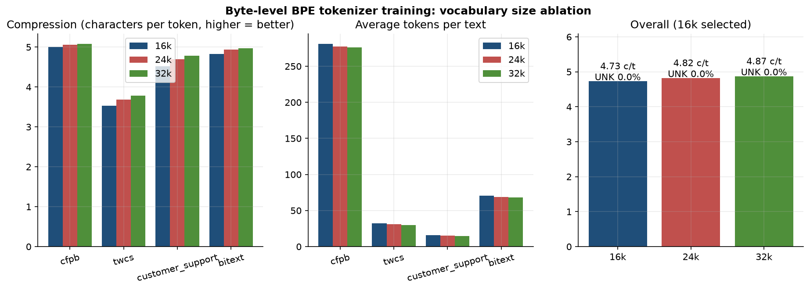 | **Tokenizer training**: byte-level BPE, 16k vs 24k vs 32k vocabulary (16k selected: 4.73 chars/token, 0% UNK) |
| 02 | 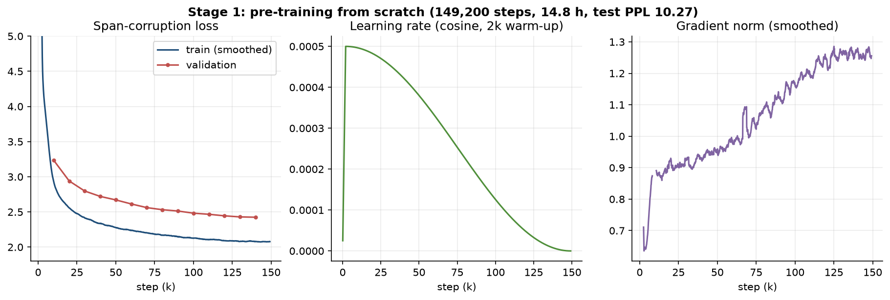 | **Pre-training** (span corruption): loss, learning rate, gradient norm; test PPL 10.27 |
| 03 | 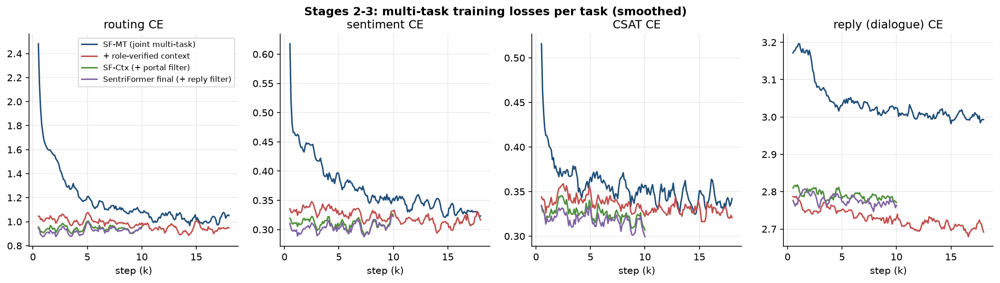 | **Multi-task training**: per-head training losses (routing, sentiment, CSAT, reply) |
| 04 | 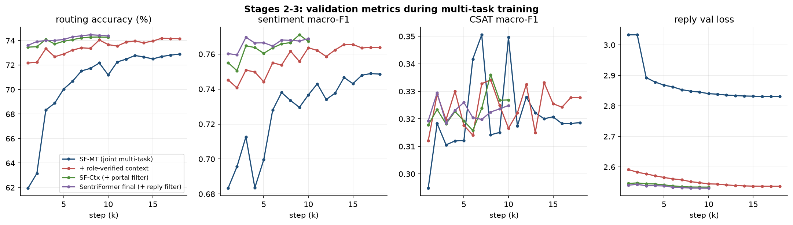 | **Multi-task training**: validation metrics every 1k steps |
| 05 | 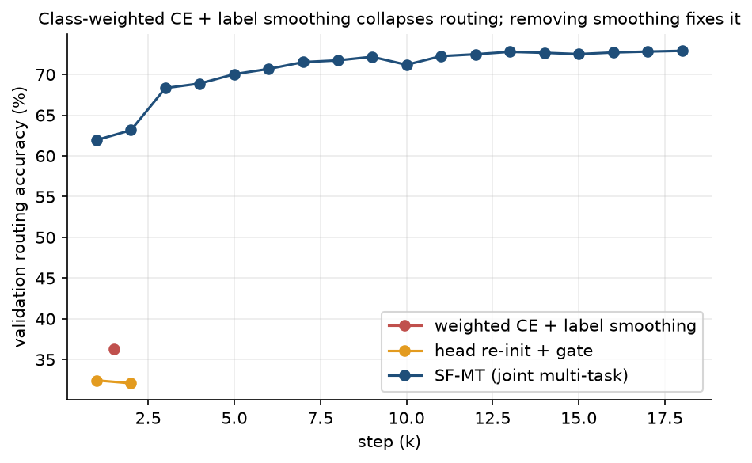 | Class-weighted CE + label smoothing collapse vs the fixed recipe |
| 06 | 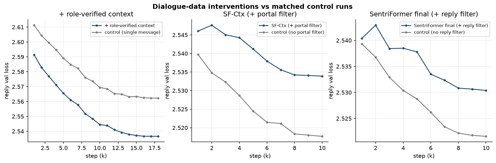 | **Dialogue SFT** data interventions vs matched control runs |
| 07 | 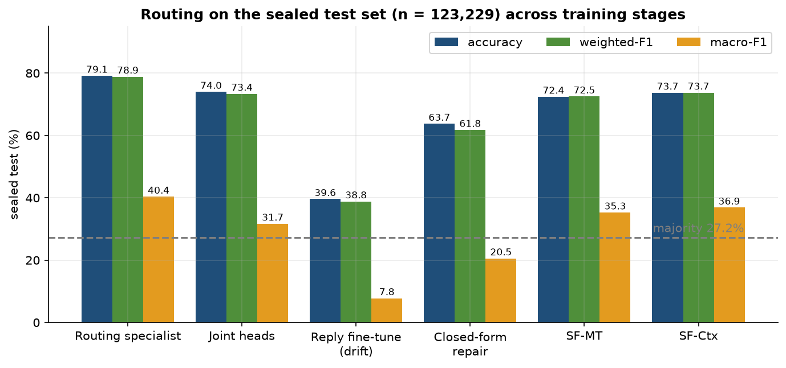 | Sealed-test routing across all training stages |
| 08 | 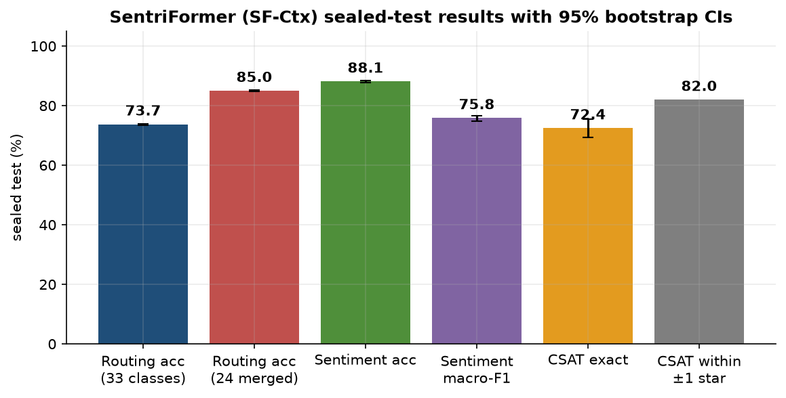 | Final sealed-test metrics with 95% bootstrap CIs |
| 09 | 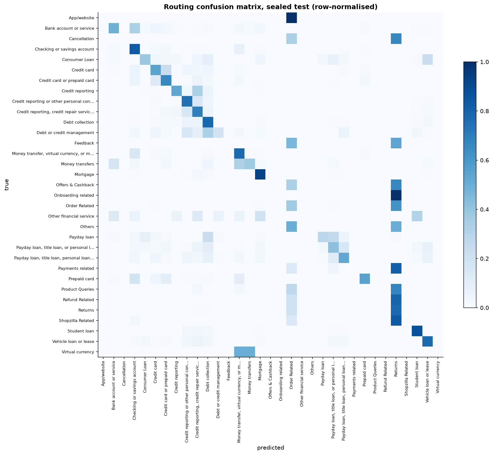 | 33×33 routing confusion matrix |
| 10 | 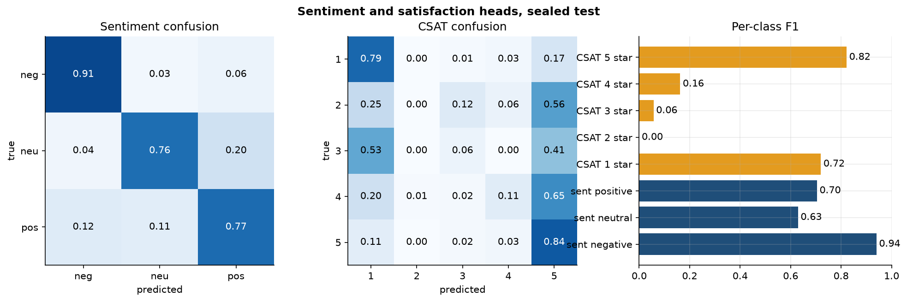 | Sentiment and CSAT heads: confusion matrices and per-class F1 |
| 11 | 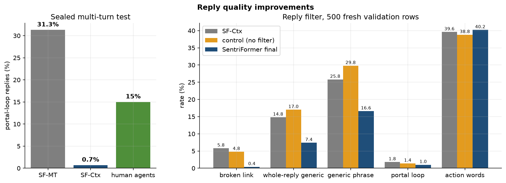 | Reply quality: portal loops 31.3% → 0.7%; reply filter vs control |
| 12 | 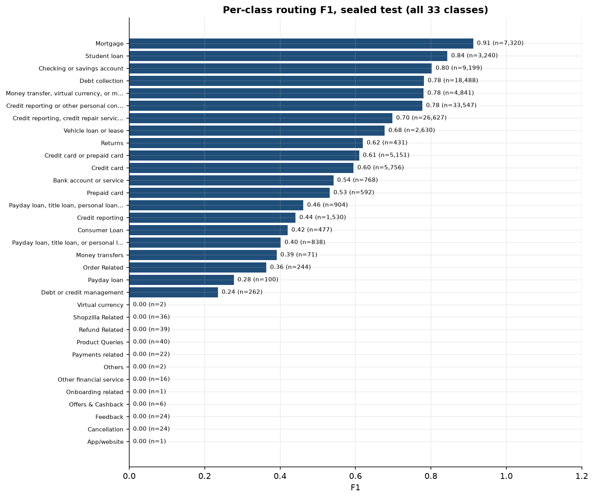 | Per-class routing F1 (all 33 classes) |

Earlier per-milestone plots (pre-training dashboard, classification, CSAT, dialogue SFT, multitask, clean SFT) are in
[`sentriformer/results/`](../../../sentriformer/results/); dataset analysis in [`docs/data_analysis/`](../../data_analysis/);
paper figures in [`research_publications/`](../../../research_publications/).
