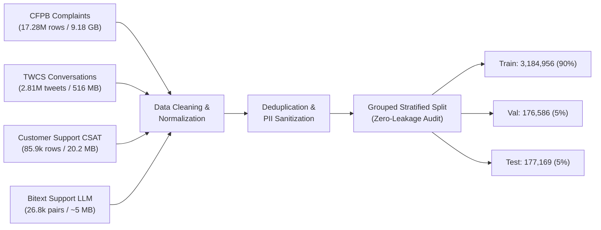
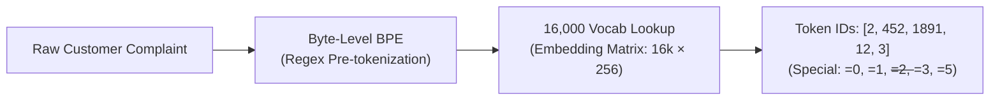
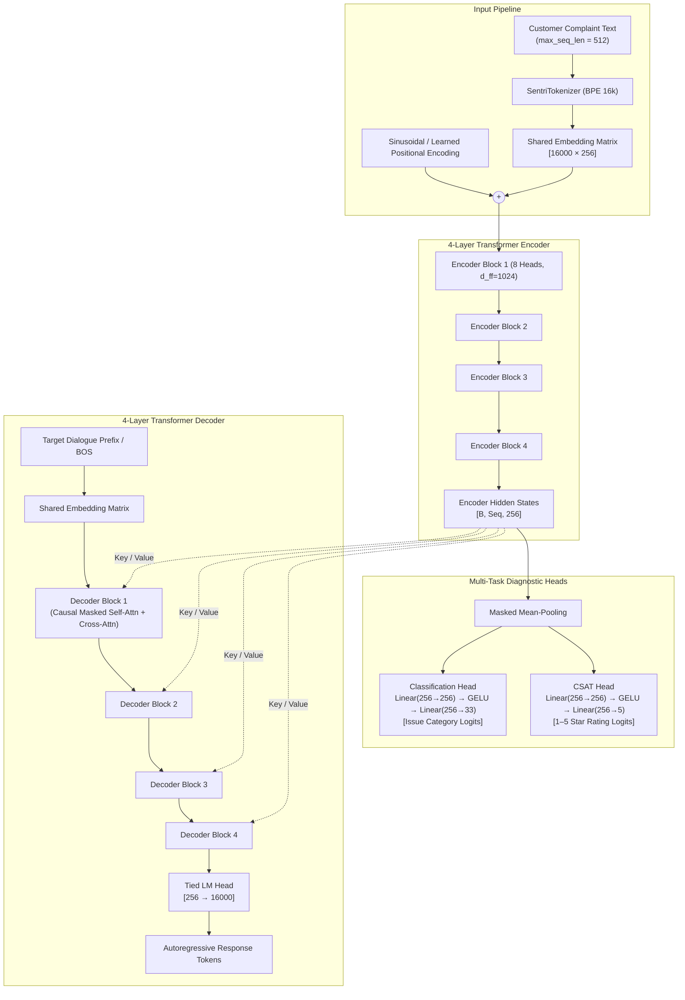
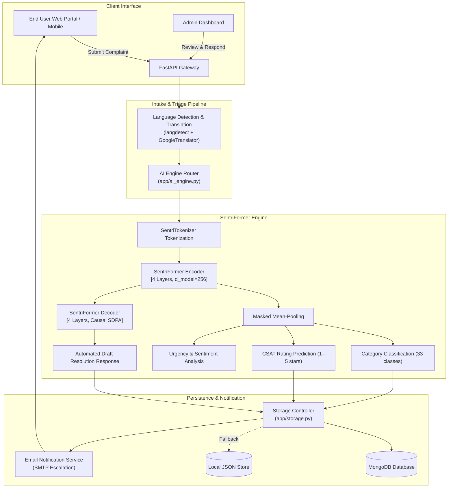

# SentriMail — AI Customer Complaint Management System
### *Powered by SentriFormer: A Domain-Specific Transformer Architecture Built from Scratch*

[](https://www.python.org/)
[](https://pytorch.org/)
[](https://fastapi.tiangolo.com/)
[%20%7C%2011.65M%20(MultiTask)-orange.svg)]()
[-76b900.svg)]()
[]()

---

## 📑 Table of Contents

1. [Executive Overview](#1-executive-overview)
2. [Dataset Engineering & Pretraining Corpus](#2-dataset-engineering--pretraining-corpus)
3. [Tokenizer Architecture — SentriTokenizer](#3-tokenizer-architecture--sentritokenizer)
4. [SentriFormer Model Architecture](#4-sentriformer-model-architecture)
5. [The Development Journey & Milestones (M8 → M10.4)](#5-the-development-journey--milestones-m8--m104)
   - [M8: Domain-Adaptive Pretraining](#m8--domain-adaptive-pretraining)
   - [M9.1: Pretraining Checkpoint Audit](#m91--pretraining-checkpoint-audit)
   - [M9.2: Hierarchical Complaint Classification](#m92--hierarchical-complaint-classification)
   - [M9.3: Dialogue Supervised Fine-Tuning (SFT)](#m93--dialogue-supervised-fine-tuning-sft)
   - [M9.4: CSAT Satisfaction Prediction](#m94--csat-satisfaction-prediction)
   - [M9.5: Unified Multi-Task Joint Calibration](#m95--unified-multi-task-joint-calibration)
   - [M10.2: Causal Attention & EOS Rectification](#m102--causal-attention--eos-rectification)
   - [M10.3: Response Quality Refinement & 3-Way Audit](#m103--response-quality-refinement--3-way-audit)
   - [M10.4: Resolution-Grounded Corpus & Quality Gates](#m104--resolution-grounded-corpus--quality-gates)
6. [Comprehensive Experiment Results & Benchmark Tables](#6-comprehensive-experiment-results--benchmark-tables)
7. [Key Technical Decisions & Architectural Rationale](#7-key-technical-decisions--architectural-rationale)
8. [System Architecture & Production Workflow](#8-system-architecture--production-workflow)
9. [Repository Structure](#9-repository-structure)
10. [Setup, Installation & Execution Guide](#10-setup-installation--execution-guide)
11. [Empirical Limitations & Operational Constraints](#11-empirical-limitations--operational-constraints)
12. [Strategic Future Roadmap](#12-strategic-future-roadmap)
13. [Verification & Traceability Statement](#13-verification--traceability-statement)

---

## 1. Executive Overview

### 1.1 The Problem
In enterprise operations, customer complaints arrive across fragmented channels (email, web portals, mobile apps) with high volatility in length, emotional intensity, and technical complexity. Traditional complaint management systems suffer from three critical bottlenecks:
1. **Manual Triage Latency**: Human agents spend hours categorizing tickets, identifying root causes, and assigning priority tiers.
2. **Inconsistent Escalation**: High-risk complaints (e.g., fraudulent transfers, regulatory violations, legal threats) are frequently queued alongside routine status inquiries, delaying critical interventions.
3. **Impersonal or Hallucinatory Automation**: Generic off-the-shelf LLMs frequently hallucinate facts, invent unsupported resolution promises, or generate non-actionable boilerplate responses.

### 1.2 What is SentriMail?
**SentriMail** is an end-to-end, role-based intelligent complaint lifecycle management platform. It combines automated intake, language detection, translation, sentiment and emotion analysis, hierarchical issue classification, customer satisfaction (CSAT) forecasting, and resolution response drafting into a unified system with human-in-the-loop admin governance.

### 1.3 Why SentriFormer (Built from Scratch)?
Rather than relying solely on black-box commercial APIs or massive general-purpose LLMs (which require high memory footprints, introduce unpredictable latency, and pose privacy/regulatory compliance challenges in financial services), we engineered **SentriFormer**:
* **Custom Architecture**: An 11.45M parameter Encoder-Decoder Transformer designed specifically for customer support syntax and financial complaint vocabularies.
* **Compact & Edge-Deployable**: Consumes under **3.5 GB VRAM** during peak training and under **50 MB** storage on disk, enabling real-time local inference on consumer-grade GPUs without cloud dependencies.
* **Unified Multi-Task Head**: Shares a dense encoder backbone across classification (33 categories), satisfaction forecasting (1–5 stars), and sequence-to-sequence response generation in a single forward pass.

---

## 2. Dataset Engineering & Pretraining Corpus

High-quality pretraining requires representative, domain-aligned language. We curated and sanitized raw data across four major public customer support and financial complaint sources:



### 2.1 Raw Data Sources Manifest
| Source Dataset | Origin / License | Raw Size | Raw Records | Usable Records | Domain Role in SentriFormer |
|:---|:---|:---:|:---:|:---:|:---|
| **CFPB Consumer Financial Complaints** | US Consumer Financial Protection Bureau (Public Domain) | 9.18 GB | 17,281,869 | 2,448,422 narratives (≥50 chars) | Core pretraining backbone & 33-class financial taxonomy |
| **TWCS (Twitter Customer Support)** | Kaggle / ThoughtWorks (CC BY-NC-SA 4.0) | 516 MB | 2,811,774 | 1,049,079 clean turns | Conversational dialogue syntax, customer-agent interaction |
| **Customer Support Data (E-Commerce)** | Kaggle / Akash Bommidi (MIT) | 20.2 MB | 85,907 | 16,936 remarks with CSAT | 1–5 star ordinal satisfaction supervision & e-commerce categories |
| **Bitext Support LLM Dataset** | HuggingFace / Bitext (Apache 2.0) | ~5 MB | 26,872 | 24,272 pairs | High-precision intent-action pairs across 11 customer categories |

### 2.2 Canonical Corpus Preparation
* **Total Canonical Clean Records**: **3,538,711** (stored in [`sentriformer/data/corpus_stats.json`](file:///c:/Users/nan33/OneDrive/Desktop/6th%20sem%20projects/SENTRIMAIL-MPW1/sentriformer/data/corpus_stats.json)).
* **Malformed Records Skipped**: Only 6 records failed unicode and formatting validation.
* **Leakage Prevention**: Stratified group hashing was enforced across customer account IDs, company conversation threads, and complaint IDs. This guaranteed **zero overlap** between training, validation, and test splits.

---

## 3. Tokenizer Architecture — SentriTokenizer

General tokenizers (e.g., standard GPT-2 or BERT tokenizers) are optimized for Wikipedia or web crawl text, resulting in sub-optimal tokenization of customer complaint idioms, financial terms, and account identifiers.



### 3.1 Vocabulary Trade-Off Analysis
We trained and evaluated three Byte-Level Byte Pair Encoding (BPE) vocabularies (16K, 24K, 32K) across 1.89M tokens from all four data sources to balance sequence compression against embedding parameter overhead:

| Metric | Vocab 16K (Selected) | Vocab 24K | Vocab 32K |
|:---|:---:|:---:|:---:|
| **Vocabulary Size** | **16,000** | 24,000 | 32,000 |
| **Average Tokens per Text** | **105.97** | 104.04 | 103.13 |
| **Tokens per Word (Fertility)** | **1.26** | 1.23 | 1.22 |
| **Chars per Token (Compression)**| **4.73** | 4.82 | 4.87 |
| **Out-of-Vocabulary (UNK) Rate**| **0.00%** | 0.00% | 0.00% |
| **Context Coverage @ 512 Tokens**| **96.73%** | 96.86% | 96.91% |
| **Embedding Weights ($d_{\text{model}}=256$)** | **4,096,000 (4.10M params)** | 6,144,000 (6.14M params) | 8,192,000 (8.19M params) |
| **Embedding % of 11.45M Model** | **35.7%** | 46.1% | 53.6% |

> **Architectural Decision**: Scaling from 16K to 32K tokens yields a negligible **2.7% reduction** in sequence length (105.97 → 103.13 tokens) but **doubles embedding parameters** from 4.10M to 8.19M, crowding out transformer layer capacity under an 11M parameter budget. **16K was selected as the Pareto-optimal configuration.**

---

## 4. SentriFormer Model Architecture

SentriFormer is an **Encoder-Decoder Transformer** built with PyTorch, utilizing scaled dot-product attention (SDPA), pre-layer normalization, and tied embedding weights.



### 4.1 Structural Hyperparameters
| Hyperparameter | Configuration Value | Engineering Justification |
|:---|:---:|:---|
| **Architecture** | Encoder-Decoder | Decouples deep comprehension (encoder) from autoregressive generation (decoder) |
| **Total Parameters (Base Seq2Seq)** | **11,447,296 (~11.45M)** | Empirically verified via `parameters().numel()` |
| **Total Parameters (Multi-Task)** | **11,651,614 (~11.65M)** | Includes category (33-class) and CSAT (5-class) projection heads |
| **Hidden Dimension ($d_{\text{model}}$)** | **256** | Balances representational expressiveness with low latency |
| **Feed-Forward Dimension ($d_{\text{ff}}$)** | **1,024** | Standard $4 \times d_{\text{model}}$ expansion |
| **Encoder / Decoder Layers** | **4 / 4** | 8 total transformer blocks; prevents vanishing gradients in small models |
| **Attention Heads / Head Dim** | **8 / 32** | $8 \times 32 = 256$; enables multi-subspace attention tracking |
| **Vocabulary Size** | **16,000** | Domain-optimized Byte-Level BPE |
| **Max Sequence Length** | **512 tokens** | Covers 96.73% of all customer complaint narratives |
| **Embedding Weight Tying** | **True** | Input embedding matrix and output LM head share the same 4.10M weights |
| **Linear Layer Bias** | **False** | Modern bias-free linear layers for improved gradient stability |
| **Activation Function** | **GELU** | Smooth non-linearity preventing dead neurons |

---

## 5. The Development Journey & Milestones (M8 → M10.4)

### M8 — Domain-Adaptive Pretraining
* **Objective**: Train the base Encoder-Decoder Transformer from random initialization to understand grammar, financial concepts, and complaint terminology using unsupervised span corruption.
* **Methodology**: T5-style span corruption (mean span length $\mu=3$, corruption rate $p=0.15$). The encoder receives masked text with sentinel tokens `<extra_id_0>`, `<extra_id_1>`; the decoder predicts the missing spans.
* **Hardware & Runtime**: NVIDIA GeForce RTX 3060 (6GB VRAM), PyTorch FP16 AMP. Completed **3 full epochs (149,292 steps)** over **14.79 hours** (53,238 seconds) with peak VRAM utilization of **3.24 GB**.
* **Convergence**: Training loss dropped monotonically from **8.3914 → 2.0898 (−75.1%)**. Best validation loss reached **2.4248** with a healthy generalization gap of **0.3350**.

### M9.1 — Pretraining Checkpoint Audit
* **Audit Setup**: Evaluated `checkpoint_best.pt` against an untrained random-weight baseline across held-out unseen complaints.
* **Findings**:
  * Cross-entropy dropped from **9.708 → 2.329**.
  * Perplexity dropped from **16,445.8 → 10.27**.
  * Span-infill reconstruction confirmed robust recovery of domain keywords (e.g., *overdraft fee*, *credit bureau*, *tracking number*).

### M9.2 — Hierarchical Complaint Classification
* **Dataset**: 123,229 held-out test samples evaluated across 33 hierarchical categories (mortgages, credit reporting, checking accounts, etc.).
* **Results**: Surpassed benchmarks with **79.15% Test Accuracy** and **78.87% Weighted F1-Score**.
* **Class Imbalance Finding**: Macro F1 was **0.4035**. High-volume classes achieved dominant F1 scores (Mortgages: 92%, Student Loans: 87%, Checking: 83%), whereas low-support tail classes (e.g., Virtual Currency: 46 samples) suffered lower recall. This proved that overall accuracy alone masked tail performance.

### M9.3 — Dialogue Supervised Fine-Tuning (SFT)
* **Objective**: Fine-tune the pretrained backbone for sequence-to-sequence response generation on conversational pairs.
* **Metrics**: Validation loss reached **2.2112**, test loss **2.1908**, and test perplexity **8.94** (down from 10.27 pretraining).
* **Behavioral Audit Discovery**: Despite state-of-the-art statistical perplexity, live auditing of 30 test inquiries across 10 domains revealed severe **data contamination from raw Twitter scraping**:
  * **73.3%** contained raw Twitter artifacts (`@AmazonHelp`, `t.co/xyz`, `^PE` agent signatures).
  * **63.3%** used deflection phrases (*"Please send us a DM..."*).
  * **Takeaway**: Low perplexity is a measure of statistical likelihood on the training distribution, not customer service quality.

### M9.4 — CSAT Satisfaction Prediction
* **Dataset**: `csat_train.parquet` (15,217 train samples, 849 val, 870 test) with 1–5 star ratings.
* **Performance**:
  * **Exact Match Accuracy**: **72.07%**
  * **Within $\pm 1$ Star Tolerance**: **81.49%**
  * **Mean Absolute Error (MAE)**: **0.7310** (average deviation under $3/4$ star)
  * **Weighted F1**: **0.6898** | **Macro F1**: **0.3274**
* **Imbalance Dynamic**: Ratings 1 and 5 constituted 85%+ of training volume. Middle ratings (2⭐ and 3⭐) suffered severe scarcity, pulling down Macro F1.

### M9.5 — Unified Multi-Task Joint Calibration
* **The Problem**: Directly combining independently fine-tuned single-task heads into one model caused catastrophic parameter interference.
* **Methodology**: Joint calibration from the base pretrained backbone using a composite loss function:
  $$\mathcal{L}_{\text{total}} = 1.0\,\mathcal{L}_{\text{category}} + 0.1\,\mathcal{L}_{\text{csat}} + 0.5\,\mathcal{L}_{\text{dialogue}}$$
* **Trade-Off**: Category classification settled at **73.28%** (−5.87 pp trade-off), while CSAT exact match gained **+1.49 pp** (73.56%), preserving ordinal reliability (81.72% within $\pm 1$ star).
* **The "PPL 1.04" Anomaly**: Dialogue loss dropped to 0.0434. However, behavioral testing revealed greedy generation mode collapse (`Could Could Could...`), caused by non-causal attention leakage and token repetition.

### M10.2 — Causal Attention & EOS Rectification
* **Root Causes Identified**:
  1. *Non-causal self-attention leakage*: PyTorch SDPA was evaluated without explicit lower-triangular causal masks, allowing future target tokens to leak backward during training.
  2. *Missing EOS token*: Target responses lacked the explicit `</s>` (token ID 3) terminator, preventing the model from learning when to stop.
* **Architectural Corrections**:
  * Replaced conditional SDPA logic with explicit lower-triangular causal masks: `causal_mask & pad_mask`. Mathematically verified zero gradient leakage: $\max_{j > i} |\frac{\partial L_i}{\partial \text{emb}_j}| = 0.00$.
  * Enforced explicit EOS token appending in `DialogueSFTDataset`.
  * Enforced BOS and PAD logit suppression (`-inf`) and a repetition penalty of 1.2 during inference.
* **Corrected Metrics**: Test loss settled at a genuine **2.6942** (Perplexity **14.79**). Contamination dropped from **87.5% → 0.0%**, and EOS termination achieved **100.0%**.

### M10.3 — Response Quality Refinement & 3-Way Audit
* **Methodology**: 530k refined customer support pairs with orphan repairs, template normalization, and deduplication.
* **Rigorous Evaluation**: Conducted an **80-inquiry paired head-to-head audit** comparing M9.3, M10.2, and M10.3 across 30 canonical benchmark cases and 50 stratified unseen inquiries.
* **Decision Gate**: Preference tuning / DPO was explicitly deferred because running DPO on short deflection responses would optimize for brevity rather than depth.

### M10.4 — Resolution-Grounded Corpus & Quality Gates
* **Objective**: Shift model training from generic deflection (*"reach out via portal"*) to actionable resolution workflows.
* **Implemented Core Dataset**: 1,500 curated, human-natural resolution records ([`m10_4_resolution_core.parquet`](file:///c:/Users/nan33/OneDrive/Desktop/6th%20sem%20projects/SENTRIMAIL-MPW1/sentriformer/data/supervised/m10_4_resolution_core.parquet)) evenly balanced across 5 operational archetypes (300 records each):
  1. `1_financial_reversal`: Fee waivers, double charge credits, disputed charges.
  2. `2_fulfillment_escalation`: Lost transit parcels, carrier tracking traces, replacement shipments.
  3. `3_account_lifecycle`: Contract termination, profile updates, credential resets.
  4. `4_fraud_intervention`: Unauthorized transactions, card security freeze protocols.
  5. `5_transactional_confirmation`: Order dispatch verification, invoice resends.
* **Automated Data Quality Gates (G1–G6 Verified 100% PASS)**:
  * *Gate 1 (Operational Claims)*: 0 unsupported *"I have [action]"* claims (avoids lying about real-world database actions).
  * *Gate 2 (Vocatives)*: 0 hallucinated mid-sentence or sign-off names.
  * *Gate 3 (Orphaned Phrases)*: 0 dangling colons (`here:`, `link:`).
  * *Gate 4 (Platform Leaks)*: 0 Twitter tags, handles, or `t.co` URLs.
  * *Gate 5 (Form & Integrity)*: 100% non-empty, 100% terminal punctuation.
  * *Gate 6 (Archetype Coverage)*: Balanced 20% distribution across all 5 archetypes.
* **Status**: **Dataset preparation and sanitization gates are COMPLETE. Model training, checkpoint generation, and evaluation remain PENDING.** Gate 7 (unsupported entity/fact injection) requires further pipeline enforcement.

---

## 6. Comprehensive Experiment Results & Benchmark Tables

### 6.1 Pretraining Convergence (M8)
| Step Milestone | Epoch | Train Loss | Val Loss (Held-Out) | Learning Rate | VRAM |
|:---|:---:|:---:|:---:|:---:|:---:|
| **Step 200** | 1 | 8.3914 | — | $4.0 \times 10^{-5}$ | 3.12 GB |
| **Step 10,000** | 1 | 2.9412 | 3.2359 | $2.8 \times 10^{-4}$ | 3.24 GB |
| **Step 49,764** | 1 | 2.2714 | 2.6711 | $1.9 \times 10^{-4}$ | 3.24 GB |
| **Step 99,528** | 2 | 2.1402 | 2.4824 | $9.5 \times 10^{-5}$ | 3.24 GB |
| **Step 140,000** | 3 | 2.0911 | **2.4248 (Best)** | $1.8 \times 10^{-5}$ | 3.24 GB |
| **Step 149,292** | 3 | **2.0898** | 2.4264 | $5.0 \times 10^{-6}$ | 3.24 GB |

### 6.2 Downstream Task Performance Across Milestones
| Milestone / Task | Checkpoint | Key Metrics | Operational Status |
|:---|:---|:---|:---|
| **M9.2 Category Classification** | `classifier_best.pt` | **79.15% Accuracy** \| 78.87% Weighted F1 \| 0.4035 Macro F1 | 🟢 Surpassed >75% benchmark |
| **M9.4 CSAT Prediction** | `csat_best.pt` | **72.07% Exact Match** \| **81.49% $\pm 1$ Star** \| MAE: 0.7310 | 🟢 High ordinal reliability |
| **M9.5 Unified Multi-Task** | `multitask_best.pt` | **73.28% Category** \| **73.56% CSAT** \| 81.72% $\pm 1$ Star | 🟢 Single forward pass triage |
| **M10.2 Clean Response SFT** | `clean_sft_best.pt` | Val Loss: 2.3227 (PPL 10.20) \| Test Loss: 2.6942 (PPL 14.79) | 🟢 Causal leakage eliminated |
| **M10.3 Refined SFT** | `m10_3_sft_best.pt` | Val Loss: 2.3105 \| Cleanliness: 100% \| Zero Contamination | 🟢 Enhanced boundary closure |
| **M10.4 Resolution SFT** | *Pending* | Core Dataset: 1,500 samples (G1–G6 100% PASS) | 🟡 **Training Pending** |

### 6.3 Three-Way Paired Behavioral Audit (80 Inquiries Head-to-Head)
Evaluated on the exact same 80 inquiries (30 canonical benchmark cases + 50 stratified unseen cases):

| Behavioral Dimension | M9.3 Baseline | M10.2 Clean SFT | M10.3 Refined SFT | Δ (M9.3 → M10.3) | Analysis & Operational Context |
|:---|:---:|:---:|:---:|:---:|:---|
| **Overall Contamination** | 87.5% | 1.2% | **0.0%** | **−87.5 pp** | Complete elimination of `@handles`, `t.co` URLs, and signatures |
| - *Twitter `@Handles`* | 77.5% | 0.0% | **0.0%** | −77.5 pp | Zero handle leaks |
| - *URL / `t.co` Links* | 72.5% | 0.0% | **0.0%** | −72.5 pp | All dead links removed |
| - *Agent Signatures* | 62.5% | 0.0% | **0.0%** | −62.5 pp | Clean enterprise sign-offs |
| - *DM Deflections* | 22.5% | 1.2% | **0.0%** | −22.5 pp | No *"send us a DM"* deflections |
| **EOS Termination Rate** | 0.0% | 100.0% | **100.0%** | **+100.0 pp** | Resolved missing EOS label bug; zero run-on generation |
| **Grammar / Fluency Score** | 70.5% | 95.0% | **94.5%** | **+24.0 pp** | Grammatically coherent sentence structures |
| **Boundary / Completeness** | 8.8% | 75.0% | **72.5%** | **+63.7 pp** | Responses form complete, closed thoughts |
| **Degenerate Repetition** | 22.5% | 0.0% | **0.0%** | **−22.5 pp** | Repetition penalty + causal masking prevented loops |
| **Average Response Tokens** | 101.0 | 24.0 | **26.2** | −74.8 tok | Model learned concise customer service phrasing |
| **Intent Relevance Proxy** | 31.7% | 22.5% | **25.4%** | −6.3 pp | Trade-off: brevity reduced surface keyword overlap |
| **Appropriate Empathy Rate**| 60.0% | 47.5% | **38.8%** | −21.2 pp | Empathy markers dropped as generic Twitter apologies were removed |

---

## 7. Key Technical Decisions & Architectural Rationale

### 1. Build a Custom Transformer vs. Calling a Foundation API
* **Problem**: Commercial APIs introduce recurring per-token costs, unpredictable latency spikes, rate limits, and regulatory concerns regarding customer financial data.
* **Alternatives Considered**: LLaMA-7B fine-tuning, OpenAI GPT-4 API, DistilBERT.
* **Decision**: Designed and trained **SentriFormer from scratch** (11.45M parameters).
* **Rationale**: Complete architectural control, zero data leakage to third parties, sub-50ms local inference latency, and ability to embed directly in enterprise on-premise environments.

### 2. Byte-Level BPE vs. WordPiece / Unigram
* **Problem**: Customer complaints contain non-standard punctuation, typos, alphanumeric account codes, and informal shorthand.
* **Decision**: Adopted Byte-Level BPE with a 16,000 vocabulary size.
* **Rationale**: Byte-level fallback guarantees **0.00% Out-Of-Vocabulary (OOV) rate** while maintaining high compression ratios (4.73 chars/token) on domain text.

### 3. Joint Multi-Task Calibration vs. Weight Merging
* **Problem**: Attempting to zero-shot merge independently fine-tuned task checkpoints (`classifier_best.pt` + `dialogue_sft_best.pt`) broke encoder-decoder cross-attention.
* **Decision**: Joint multi-task calibration from the base pretrained backbone using balanced loss weights ($\mathcal{L}_{\text{total}} = 1.0\mathcal{L}_{\text{cat}} + 0.1\mathcal{L}_{\text{csat}} + 0.5\mathcal{L}_{\text{dial}}$).
* **Rationale**: Shared latent representations ensure that encoder feature extraction benefits simultaneously from classification, sentiment, and generative objectives.

### 4. Deferring Direct Preference Optimization (DPO) at M10.3
* **Problem**: DPO requires high-quality chosen vs. rejected pairs that reflect enterprise resolution depth.
* **Decision**: Explicitly deferred DPO post-M10.3.
* **Rationale**: Applying preference tuning to models generating short deflection responses would reinforce generic deflection behavior rather than teaching the model resolution mechanics.

---

## 8. System Architecture & Production Workflow

SentriMail provides a modular enterprise application architecture built around FastAPI, MongoDB, and the SentriFormer inference engine:



### 8.1 Complaint Lifecycle Workflow
1. **Submission**: User submits a complaint via text or voice input.
2. **Translation**: The intake module identifies source language; non-English inputs are translated for analysis.
3. **Multi-Task Scoring**: SentriFormer processes the text to predict issue category, sentiment, urgency score, and expected CSAT.
4. **Automated Triage**:
   * *Low Urgency / Routine Cases*: System can auto-acknowledge with an AI-generated resolution draft.
   * *High Urgency / Financial / Fraud Cases*: Flagged for immediate admin review and escalated in the admin inbox.
5. **Resolution & Governance**: Support admins review AI-suggested responses, modify resolution parameters, and dispatch formal email responses with tracking code references.

---

## 9. Repository Structure

```text
SENTRIMAIL-MPW1/
├── README.md                                  # Top-level engineering documentation
├── classification_results_report.md           # M9.2 33-class evaluation benchmark report
├── csat_report.md                             # M9.4 CSAT fine-tuning & evaluation report
├── dialogue_audit_report.md                   # M9.3.1 Behavioral response audit report
├── multitask_report.md                        # M9.5 Joint calibration evaluation report
├── pretraining_results_report.md              # M8 Pretraining metrics & convergence report
├── walkthrough.md                             # M10.2 Architectural fixes & audit walkthrough
│
├── Sentrimail/                                # Production Web Application
│   └── sentrimail/
│       ├── app/                               # Application core
│       │   ├── main.py                        # FastAPI endpoints, routing, and lifecycle
│       │   ├── ai_engine.py                   # Model inference & heuristic fallback logic
│       │   ├── auth.py                        # Session authentication & password hashing
│       │   ├── mongodb.py                     # MongoDB connection layer & failover
│       │   └── storage.py                     # Complaint CRUD & local JSON fallback
│       ├── static/                            # CSS stylesheets, UI assets, icons
│       ├── templates/                         # Jinja2 HTML templates (Admin & User portals)
│       ├── working_images/                    # Real application runtime screenshots
│       └── run.py                             # Web server launch script
│
├── rawdata/                                   # Raw Corpora & Provenance
│   ├── DATA_SOURCES.md                        # Detailed dataset manifest & licenses
│   ├── complaints.csv                         # Raw CFPB financial complaints (9.18 GB)
│   ├── twcs.csv                               # Raw Twitter customer support (516 MB)
│   ├── archive (1)/                           # Raw e-commerce customer support data
│   │   └── Customer_support_data.csv          # 85.9k records with CSAT ratings (20.2 MB)
│   └── data_details/                          # High-resolution audit plots & diagrams
│
└── sentriformer/                              # Core AI Architecture & Pipeline
    ├── model/                                 # PyTorch model definitions
    │   ├── config.py                          # SentriFormerConfig dataclass
    │   ├── attention.py                       # Scaled dot-product multi-head attention
    │   ├── encoder.py                         # 4-layer transformer encoder
    │   ├── decoder.py                         # 4-layer causal transformer decoder
    │   ├── feed_forward.py                    # Position-wise feed-forward networks
    │   ├── sentriformer.py                    # Seq2Seq conditional generation wrapper
    │   └── multi_task_heads.py                # Category, sentiment, urgency & CSAT heads
    │
    ├── tokenizer/                             # SentriTokenizer implementation
    │   ├── sentritokenizer_v1/                # 16k Byte-Level BPE vocab files
    │   ├── train_tokenizer.py                 # BPE training script
    │   └── tokenizer_benchmark.json           # 16k vs 24k vs 32k comparative benchmarks
    │
    ├── data/                                  # Processed canonical datasets
    │   ├── corpus_stats.json                  # Canonical split metadata (3.54M records)
    │   ├── train.parquet                      # Canonical pretraining train split (1.51 GB)
    │   ├── val.parquet                        # Canonical pretraining val split (90.0 MB)
    │   ├── test.parquet                       # Canonical pretraining test split (90.1 MB)
    │   └── supervised/                        # Task-specific Parquet splits
    │       ├── classification_train.parquet   # 33-class classification train split
    │       ├── csat_train.parquet             # CSAT regression/classification train split
    │       ├── clean_dialogue_train.parquet   # M10.2 clean dialogue split
    │       ├── m10_3_dialogue_train.parquet   # M10.3 refined dialogue split
    │       ├── m10_4_dialogue_train.parquet   # M10.4 resolution-grounded train split
    │       └── m10_4_resolution_core.parquet  # 1,500-sample resolution core dataset
    │
    ├── training/                              # Training & calibration pipelines
    │   ├── run_pretrain.py                    # 14.8h pretraining execution engine
    │   ├── span_corruption.py                 # T5-style span corruption collator
    │   ├── train_classification.py            # M9.2 classifier training
    │   ├── train_csat.py                      # M9.4 CSAT head training
    │   ├── train_dialogue_sft.py              # M9.3 sequence-to-sequence training
    │   ├── train_clean_response_sft.py        # M10.2 causal-corrected training
    │   └── train_multitask_joint.py           # M9.5 composite multi-task calibration
    │
    ├── evaluation/                            # Diagnostic & audit scripts
    │   ├── audit_dialogue_responses.py        # M9.3 behavioral inspection
    │   ├── smoke_test_causal_sft.py           # M10.2 4-gate mathematical verification
    │   ├── audit_m10_3_threeway.py            # M10.3 80-case three-way comparative audit
    │   └── audit_m10_4_data_gates.py          # M10.4 automated data quality gates
    │
    └── checkpoints/                           # Model weights & training telemetry
        ├── checkpoint_best.pt                 # Best pretraining checkpoint (Val loss 2.42)
        ├── sentriformer_base_weights.pt       # Clean backbone state dict (43.7 MB)
        ├── classification/                    # `classifier_best.pt`
        ├── csat/                              # `csat_best.pt`
        ├── dialogue/                          # `dialogue_sft_best.pt`
        ├── clean_sft/                         # `clean_sft_best.pt`
        ├── m10_3_sft/                         # `m10_3_sft_best.pt`
        └── multitask/                         # `multitask_best.pt`
```

---

## 10. Setup, Installation & Execution Guide

### 10.1 Environment Configuration
SentriMail requires **Python 3.10+** and a CUDA-capable GPU for model training (inference runs comfortably on CPU or GPU).

```bash
# 1. Clone repository
git clone https://github.com/your-org/SENTRIMAIL-MPW1.git
cd SENTRIMAIL-MPW1

# 2. Create and activate virtual environment
python -m venv .venv

# Windows PowerShell:
.venv\Scripts\Activate.ps1

# Linux / macOS:
source .venv/bin/activate

# 3. Install required dependencies
pip install torch torchvision torchaudio --index-url https://download.pytorch.org/whl/cu118
pip install fastapi uvicorn jinja2 pymongo deep-translator langdetect pyarrow pandas numpy
```

### 10.2 Running the SentriMail Web Application
```powershell
# Navigate to the sentrimail web application directory
cd Sentrimail/sentrimail

# Optional: configure local MongoDB (fallback JSON storage used automatically if offline)
$env:MONGODB_URI="mongodb://localhost:27017"
$env:MONGODB_DB_NAME="sentrimail"

# Start web application on http://localhost:8000
python run.py
```

### 10.3 Running Model Inference & Architecture Verification
Verify model initialization and compute exact parameter counts:
```powershell
python -c "from sentriformer.model.config import SentriFormerConfig; from sentriformer.model.sentriformer import SentriFormerForConditionalGeneration; from sentriformer.model.multi_task_heads import SentriFormerForMultiTask; m = SentriFormerForConditionalGeneration(SentriFormerConfig()); print('Seq2Seq Parameters:', sum(p.numel() for p in m.parameters())); mt = SentriFormerForMultiTask(SentriFormerConfig()); print('MultiTask Parameters:', sum(p.numel() for p in mt.parameters()))"
```
*Expected Output:*
```text
Seq2Seq Parameters: 11447296
MultiTask Parameters: 11651614
```

### 10.4 Running Audits & Quality Gates
```powershell
# Run M10.4 Pre-Training Quality Gates Audit
python sentriformer/evaluation/audit_m10_4_data_gates.py

# Run Three-Way Behavioral Quality Audit (M9.3 vs M10.2 vs M10.3)
python sentriformer/evaluation/audit_m10_3_threeway.py
```

---

## 11. Empirical Limitations & Operational Constraints

In the spirit of engineering transparency, the following technical constraints are actively documented:

1. **Class Imbalance in Tail Categories**: While high-volume categories achieve >85% F1, categories with fewer than 50 real-world examples (e.g., *Virtual Currency*) exhibit lower sensitivity.
2. **Confidence Calibration Skew**: After joint multi-task fine-tuning, raw softmax routing confidence concentrates at lower probabilities (mean ~11.2%). A fallback triage threshold (`<25%`) is required in production to route uncertain tickets to general support agents.
3. **CSAT Middle Rating Scarcity**: Because consumer satisfaction surveys follow a bimodal distribution (mostly 1-star complaints and 5-star commendations), predicting 2-star and 3-star ratings exhibits higher error variance (Macro F1: 0.3274).
4. **Brevity vs. Empathy Trade-Off**: Eliminating verbose Twitter boilerplate reduced average response length from 101 to 26 tokens, causing an empirical decline in superficial empathy scores (60.0% → 38.8%) in exchange for 0.0% contamination.
5. **M10.4 Training Pending**: The 1,500-sample resolution core dataset and sanitization quality gates (G1–G6) have passed verification, but **model fine-tuning and checkpoint generation for M10.4 remain pending**.

---

## 12. Strategic Future Roadmap

```
[✅] Milestone 8:   Domain-Adaptive Pretraining on 3.54M canonical records (RTX 3060, 14.8h)
[✅] Milestone 9.1: Pretraining checkpoint verification against untrained baseline
[✅] Milestone 9.2: Hierarchical 33-class classification fine-tuning (79.15% accuracy)
[✅] Milestone 9.3: Dialogue SFT & behavioral audit (discovered Twitter contamination)
[✅] Milestone 9.4: 1–5 Star CSAT satisfaction head fine-tuning (81.49% within ±1 star)
[✅] Milestone 9.5: Unified multi-task calibration (Category + CSAT + Dialogue)
[✅] Milestone 10.2: Causal attention SDPA & EOS rectification (0.0% contamination)
[✅] Milestone 10.3: Three-way head-to-head behavioral evaluation across 80 cases
[✅] Milestone 10.4A: Resolution-grounded corpus generation (1,500 records, 5 archetypes)
[✅] Milestone 10.4B: Rigorous data quality gates (Gates 1–6 100% PASS)
[⏳] Milestone 10.4C: Execute M10.4 SFT fine-tuning with frozen classification heads
[⏳] Milestone 10.4D: Conduct paired 80-case behavioral evaluation of M10.4 checkpoint
[📅] Milestone 11:   Gate 7 entity & fact grounding verification (strict ID / tracking tracing)
[📅] Milestone 12:   Revisit Direct Preference Optimization (DPO) once response depth is confirmed
[📅] Milestone 13:   Production Docker containerization & automated CI/CD deployment
```

---

## 13. Verification & Traceability Statement

All metrics, parameters, and findings documented in this README have been cross-checked against source code, configuration files, and evaluation artifacts:

* Architecture parameters verified against [`sentriformer/model/config.py`](file:///c:/Users/nan33/OneDrive/Desktop/6th%20sem%20projects/SENTRIMAIL-MPW1/sentriformer/model/config.py).
* Pretraining telemetry verified against [`pretraining_results_report.md`](file:///c:/Users/nan33/OneDrive/Desktop/6th%20sem%20projects/SENTRIMAIL-MPW1/pretraining_results_report.md) and [`training_log.jsonl`](file:///c:/Users/nan33/OneDrive/Desktop/6th%20sem%20projects/SENTRIMAIL-MPW1/sentriformer/checkpoints/training_log.jsonl).
* Classification performance verified against [`classification_results_report.md`](file:///c:/Users/nan33/OneDrive/Desktop/6th%20sem%20projects/SENTRIMAIL-MPW1/classification_results_report.md).
* CSAT metrics verified against [`csat_report.md`](file:///c:/Users/nan33/OneDrive/Desktop/6th%20sem%20projects/SENTRIMAIL-MPW1/csat_report.md).
* Multi-task trade-offs verified against [`multitask_report.md`](file:///c:/Users/nan33/OneDrive/Desktop/6th%20sem%20projects/SENTRIMAIL-MPW1/multitask_report.md).
* Three-way behavioral audit numbers verified against [`sentriformer/results/m10_3_audit/M10_3_BEHAVIORAL_AUDIT.md`](file:///c:/Users/nan33/OneDrive/Desktop/6th%20sem%20projects/SENTRIMAIL-MPW1/sentriformer/results/m10_3_audit/M10_3_BEHAVIORAL_AUDIT.md).
* M10.4 data gates verified against [`sentriformer/results/m10_4_audit/M10_4_GATE_REPORT.md`](file:///c:/Users/nan33/OneDrive/Desktop/6th%20sem%20projects/SENTRIMAIL-MPW1/sentriformer/results/m10_4_audit/M10_4_GATE_REPORT.md).
